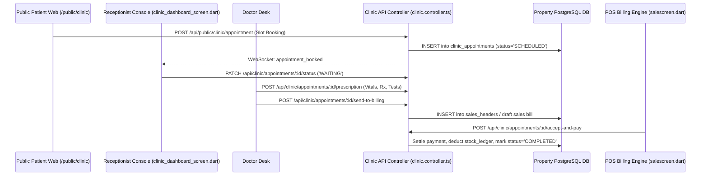
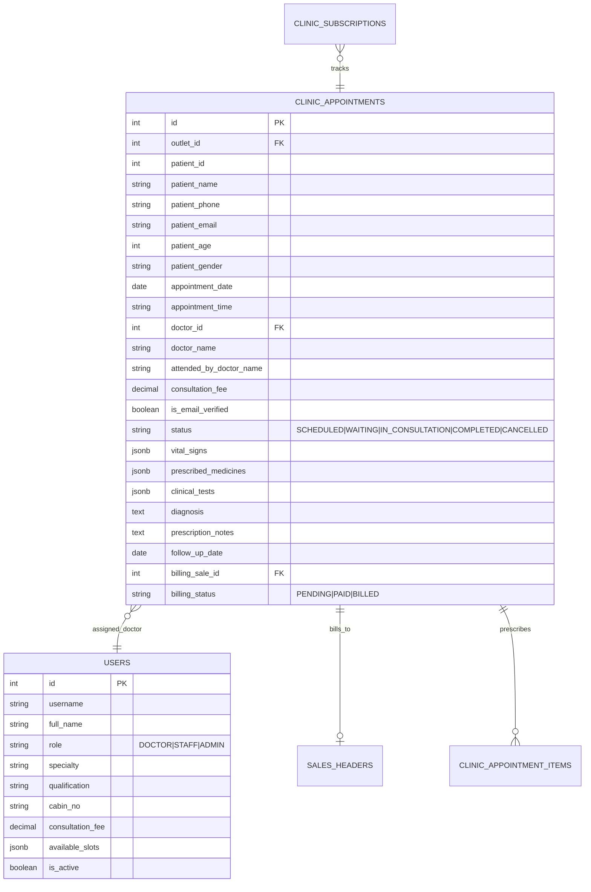
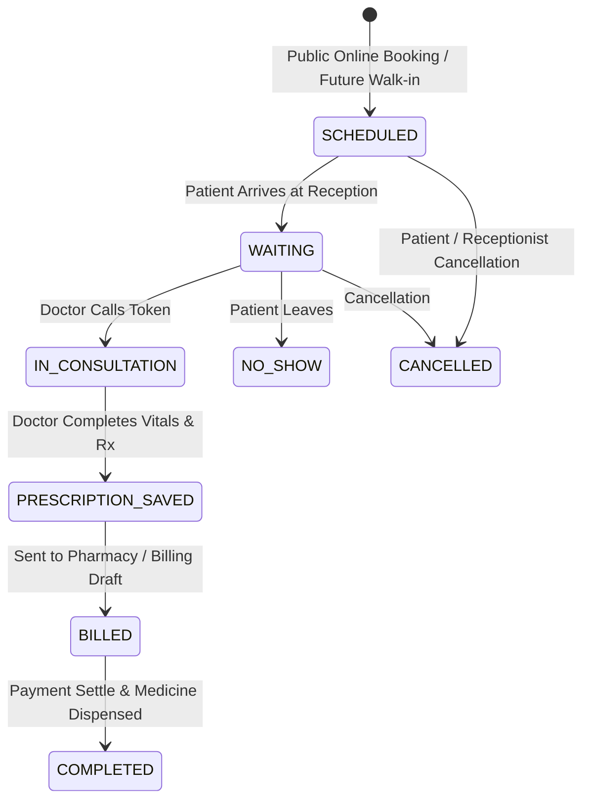
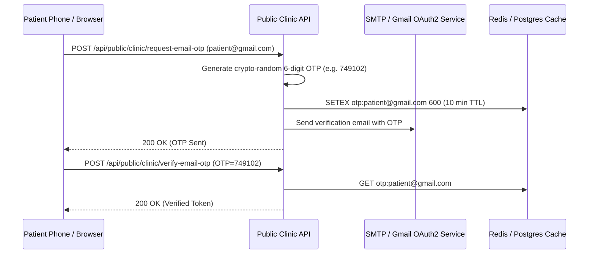

# Developer Guide: Clinic Management, OPD Queue & Digital Prescription Architecture

This document provides deep technical specifications for full-stack engineers, backend architects, and mobile developers on the **Famalth Lynx Clinic & OPD Suite**, **Doctor Consultation Desk**, **Digital Prescription Pipeline**, and **Public Patient Booking Engine**.

---

## 📑 Table of Contents
1. [Architectural Overview & Data Flow](#1-architectural-overview--data-flow)
2. [Database Schemas & Entity Relationships](#2-database-schemas--entity-relationships)
3. [Appointment Lifecycle & State Machine](#3-appointment-lifecycle--state-machine)
4. [Clinic REST API Reference (`/api/clinic/*`)](#4-clinic-rest-api-reference-apiclinic)
5. [Public Patient Portal REST API (`/api/public/clinic/*`)](#5-public-patient-portal-rest-api-apipublicclinic)
6. [Pharmacy Billing Bridge (`sendToBillingDraft` & `acceptAndPay`)](#6-pharmacy-billing-bridge-sendtobillingdraft--acceptandpay)
7. [Digital Prescription Vector PDF Generation](#7-digital-prescription-vector-pdf-generation)
8. [Public Patient Email OTP Verification State Machine](#8-public-patient-email-otp-verification-state-machine)
9. [Flutter State Management Architecture](#9-flutter-state-management-architecture)
10. [Testing & Verification Commands](#10-testing--verification-commands)

---

## 1. Architectural Overview & Data Flow



---

## 2. Database Schemas & Entity Relationships

The clinic subsystem is backed by Sequelize models in `backend/models/property/`:



### Vital Signs JSONB Schema:
```json
{
  "blood_pressure": "120/80",
  "pulse_rate": 72,
  "temperature_f": 98.6,
  "weight_kg": 74.0,
  "height_cm": 175.0,
  "bmi": 24.2,
  "spo2": 99,
  "blood_sugar_fasting": 95,
  "blood_sugar_pp": 130
}
```

### Prescribed Medicines JSONB Schema:
```json
[
  {
    "item_id": 204,
    "medicine_name": "Amoxicillin 500mg",
    "dosage": "1-0-1",
    "timing": "After Food",
    "duration_days": 5,
    "quantity": 10,
    "unit_rate": 12.50,
    "instructions": "Complete full 5-day course"
  }
]
```

---

## 3. Appointment Lifecycle & State Machine



---

## 4. Clinic REST API Reference (`/api/clinic/*`)

Mounted on `/api/clinic` via `backend/routes/clinic.routes.ts`. Protected by standard JWT `auth.middleware`.

### 1. Appointments & Queue
- `GET /api/clinic/appointments`:
  - Query Params: `?date=YYYY-MM-DD&doctor_id=...&status=WAITING&search=Rajesh`.
  - Returns array of `clinic_appointments` with populated doctor details.
- `POST /api/clinic/appointments`:
  - Request: `{ outlet_id, patient_name, patient_phone, patient_email, patient_age, patient_gender, appointment_date, appointment_time, doctor_id, consultation_fee, reason_for_visit }`.
  - Creates appointment and returns assigned token number.
- `PATCH /api/clinic/appointments/:id/status`:
  - Request: `{ status: 'WAITING' | 'IN_CONSULTATION' | 'COMPLETED' | 'CANCELLED' | 'NO_SHOW' }`.
- `POST /api/clinic/appointments/:id/prescription`:
  - Request: `{ vital_signs, diagnosis, prescribed_medicines, clinical_tests, advice_notes, follow_up_date }`.
  - Atomically saves clinical consultation data.

### 2. Consultation Payment & Direct Billing
- `POST /api/clinic/appointments/:id/accept-and-pay`:
  - Request: `{ payment_mode: 'Cash' | 'UPI' | 'Card', amount: 525.00, reference_no: 'UPI-883' }`.
  - Generates sales invoice, marks appointment as `PAID`, and logs cash ledger entry.
- `POST /api/clinic/appointments/:id/send-to-billing`:
  - Converts prescribed medicines and consult fee into an active draft sales invoice in `sales_headers` for pharmacy cashier checkout.

### 3. Doctors Directory & Stock
- `GET /api/clinic/doctors`: List active clinic doctors, specialties, consulting fees, and room numbers.
- `POST /api/clinic/doctors`: Register new doctor profile in `users`.
- `PUT /api/clinic/doctors/:id`: Update qualifications, room number, or fee.
- `GET /api/clinic/medicines`: Search clinic pharmacy inventory (`item_master`) with live stock count and batch expiry.
- `GET /api/clinic/analytics`: Aggregated patient counts, doctor-wise revenue, and OPD fee totals.

---

## 5. Public Patient Portal REST API (`/api/public/clinic/*`)

Public endpoints mounted on `/api/public/clinic/*` in `backend/routes/public.routes.ts`:

- `GET /api/public/clinic/cities`: Returns list of cities where doctors are active.
- `GET /api/public/clinic/specialities`: Returns available medical specialties.
- `GET /api/public/clinic/doctors`: Query params `?city=...&speciality=...`.
- `POST /api/public/clinic/request-email-otp`: Generates a 6-digit email OTP for patient authentication.
- `POST /api/public/clinic/verify-email-otp`: Validates OTP and returns patient verification token.
- `POST /api/public/clinic/appointment`: Books patient appointment.
- `GET /api/public/clinic/patient-history`: Query params `?patient_email=...&patient_phone=...`. Returns past visits and prescription URLs.
- `POST /api/public/clinic/cancel-appointment`: Cancels an upcoming appointment.
- `GET /api/public/clinic/operating-status`: Checks if clinic is open today or closed for holidays.

---

## 6. Pharmacy Billing Bridge (`sendToBillingDraft` & `acceptAndPay`)

Located in `backend/controllers/clinic/clinic.controller.ts`:

```typescript
export const sendToBillingDraft = async (req: Request, res: Response) => {
  const { id } = req.params;
  const appointment = await propertyDb.models.clinic_appointments.findByPk(id);
  
  // Transform prescribed_medicines into sales_items
  const saleItems = appointment.prescribed_medicines.map((m: any) => ({
    item_id: m.item_id,
    item_name: m.medicine_name,
    quantity: m.quantity,
    unit_rate: m.unit_rate,
    total_amount: m.quantity * m.unit_rate,
    notes: `${m.dosage} - ${m.timing}`
  }));

  // Create draft sales header
  const draftSale = await propertyDb.models.sales_headers.create({
    outlet_id: appointment.outlet_id,
    customer_name: appointment.patient_name,
    customer_phone: appointment.patient_phone,
    is_draft: true,
    status: 'Draft',
    items: saleItems
  }, { include: ['items'] });

  await appointment.update({ billing_sale_id: draftSale.id, billing_status: 'BILLED' });
  return res.json({ success: true, draftSaleId: draftSale.id });
};
```

---

## 7. Digital Prescription Vector PDF Generation

Implemented in `lib/screens/clinic/clinic_prescription_pdf.dart` using the `pdf` package:

### Rendering Components:
1. **Clinic Header**: Clinic name, address, tax identifier, contact numbers.
2. **Doctor Block**: Doctor name, degrees/qualifications, medical council registration number.
3. **Patient & Vitals Grid**: 2-column tabular grid displaying BP, Pulse, Temp, Weight, Height, BMI.
4. **Clinical Findings**: Chief Complaints and Diagnosis block.
5. **Rx Medicine Table**: Clean tabular layout:
   - Medicine Name & Strength
   - Dosage (e.g. `1 - 0 - 1`)
   - Duration (e.g. `5 Days`)
   - Instructions (`After Food`)
6. **Diagnostic Investigations & Advice**: Lab tests ordered and lifestyle advice.
7. **Footer**: Follow-up date and doctor's digital signature placeholder.

---

## 8. Public Patient Email OTP Verification State Machine



---

## 9. Flutter State Management Architecture

- **`ClinicDashboardScreen`** (`lib/screens/clinic/clinic_dashboard_screen.dart`):
  - Tab Controller: Manages 4 tabs (Appointments, Doctor Desk, Pharmacy Desk, Analytics).
  - Search & Filter State: Date selector, doctor dropdown, token search, and status chips.
  - Periodic Polling & Socket Listener: Auto-refreshes token queue every 15 seconds.
- **`PublicAppointmentBookingScreen`** (`lib/screens/clinic/public_appointment_booking_screen.dart`):
  - Explore Tab: City dropdown, horizontal specialty chips, doctor cards with booking buttons.
  - History Tab: Patient authentication persistence, active booking cards, past prescription downloads.

---

## 10. Testing & Verification Commands

### 1. Test Creating a Walk-in Appointment:
```bash
curl -X POST http://localhost:5000/api/clinic/appointments \
  -H "Authorization: Bearer <STAFF_JWT>" \
  -H "Content-Type: application/json" \
  -d '{
    "outlet_id": 1,
    "patient_name": "Sunil Varma",
    "patient_phone": "9876500001",
    "patient_age": 35,
    "patient_gender": "Male",
    "appointment_date": "2026-10-26",
    "appointment_time": "10:30 AM",
    "doctor_id": 2,
    "consultation_fee": 500.00,
    "reason_for_visit": "Fever & Cough"
  }'
```

### 2. Test Doctor Saving Prescription:
```bash
curl -X POST http://localhost:5000/api/clinic/appointments/101/prescription \
  -H "Authorization: Bearer <DOCTOR_JWT>" \
  -H "Content-Type: application/json" \
  -d '{
    "vital_signs": { "blood_pressure": "120/80", "pulse_rate": 74, "temperature_f": 99.1 },
    "diagnosis": "Viral Bronchitis",
    "prescribed_medicines": [
      { "item_id": 101, "medicine_name": "Paracetamol 650mg", "dosage": "1-0-1", "duration_days": 3, "quantity": 6 }
    ],
    "follow_up_date": "2026-10-29"
  }'
```

### 3. Test Public Doctor Discovery:
```bash
curl -X GET "http://localhost:5000/api/public/clinic/doctors?speciality=Cardiology"
```
