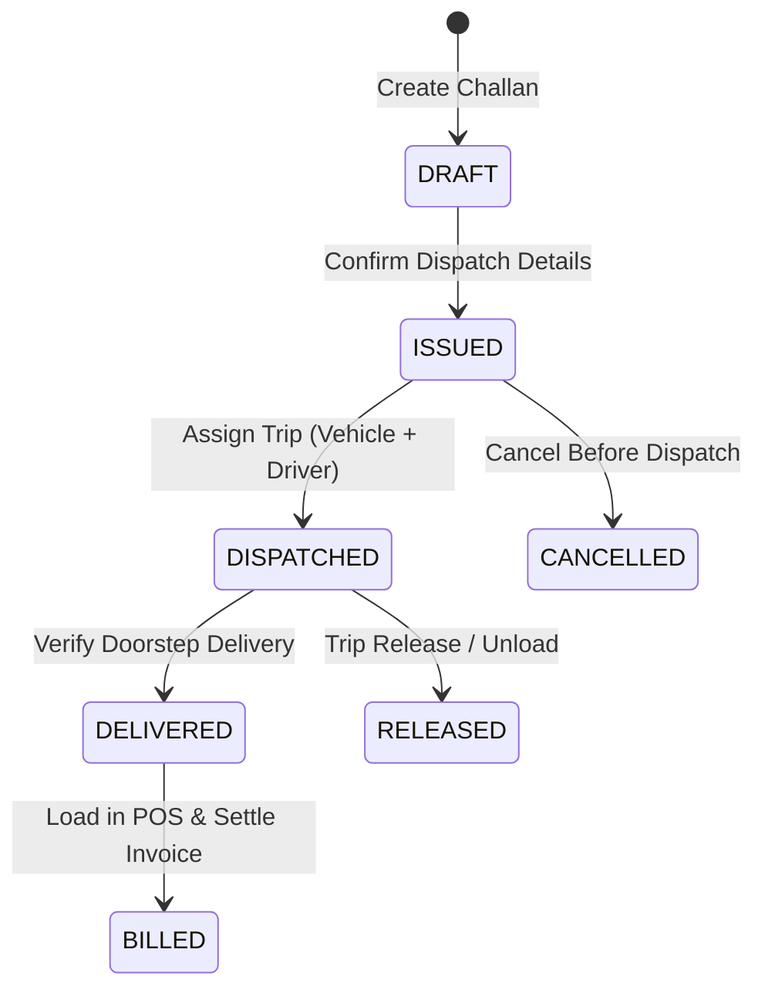
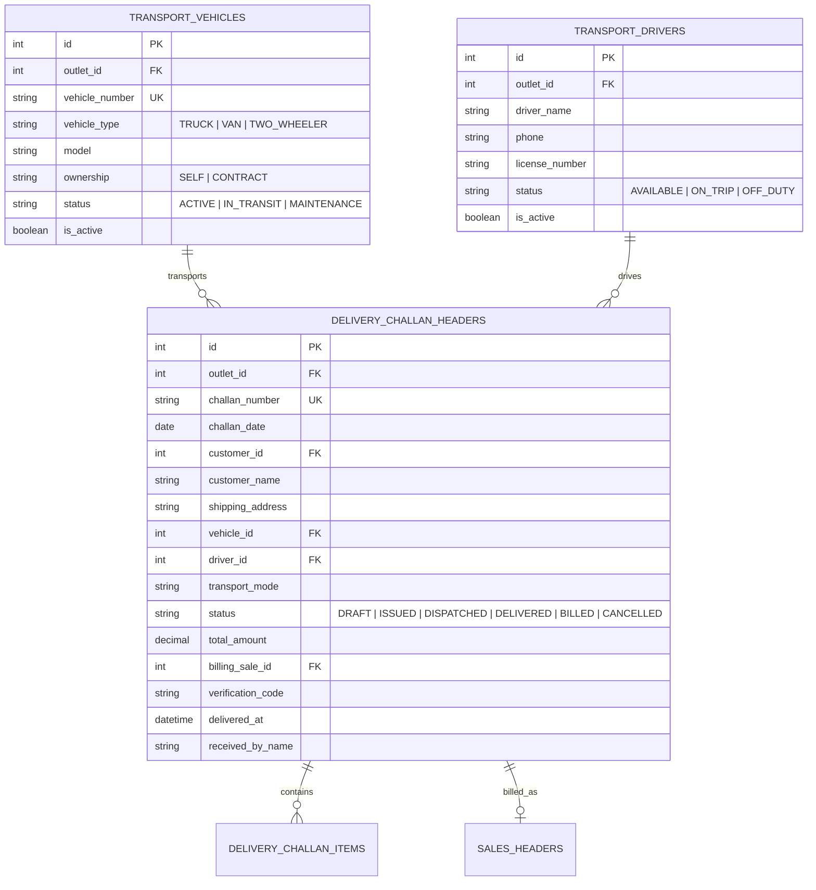

# Developer Guide: Delivery Challan, Fleet Vehicles & Transport Logistics Architecture

This technical document details the architecture, relational database schemas, REST APIs, state transitions, and billing conversion pipeline for the **Famalth Lynx Transport & Delivery Challan Subsystem**.

---

## 📑 Table of Contents
1. [Architecture & Logistics State Machine](#1-architecture--logistics-state-machine)
2. [Database Schemas & Entity Relationships](#2-database-schemas--entity-relationships)
3. [Transport REST API Reference (`/api/transport/*`)](#3-transport-rest-api-reference-apitransport)
4. [Challan REST API Reference (`/api/restaurant/challan/*`)](#4-challan-rest-api-reference-apirestaurantchallan)
5. [Trip Assignment & Loading Manifest Engine](#5-trip-assignment--loading-manifest-engine)
6. [POS Conversion Pipeline (`_openInBillingScreen`)](#6-pos-conversion-pipeline-_openinbillingscreen)
7. [Vector PDF Challan Generation](#7-vector-pdf-challan-generation)
8. [Testing & Verification Commands](#8-testing--verification-commands)

---

## 1. Architecture & Logistics State Machine



---

## 2. Database Schemas & Entity Relationships

The transport subsystem models are located in `backend/models/property/`:



---

## 3. Transport REST API Reference (`/api/transport/*`)

Mounted on `/api/transport` via `backend/routes/transport.routes.ts`. Protected by standard JWT authentication.

### 1. Fleet Vehicle Endpoints
- `GET /api/transport/vehicles`: List all vehicles for the outlet.
- `POST /api/transport/vehicles`: Register a new fleet vehicle.
  - Body: `{ vehicle_number, vehicle_type, model, ownership, notes }`.
- `PUT /api/transport/vehicles/:id`: Update vehicle details or maintenance status.
- `DELETE /api/transport/vehicles/:id`: Soft delete / archive vehicle.

### 2. Driver Endpoints
- `GET /api/transport/drivers`: List active drivers.
- `POST /api/transport/drivers`: Register driver profile.
  - Body: `{ driver_name, phone, license_number }`.
- `PUT /api/transport/drivers/:id`: Update driver phone or duty status.
- `DELETE /api/transport/drivers/:id`: Soft delete driver profile.

### 3. Trip & Dispatch Logistics
- `POST /api/transport/assign-trip`: Assigns a vehicle and driver to one or more challans.
  - Body: `{ challan_ids: [12, 13], vehicle_id: 3, driver_id: 5, start_km: 14200, route_notes: "North Zone" }`.
  - Atomically updates challan statuses to `DISPATCHED` and vehicle status to `IN_TRANSIT`.
- `POST /api/transport/verify-delivery`: Confirms doorstep drop-off.
  - Body: `{ challan_id: 12, received_by_name: "Rahul Verma", verification_code: "5821", notes: "All intact" }`.
  - Updates status to `DELIVERED` and records `delivered_at` timestamp.
- `POST /api/transport/release-trip`: Completes trip run and frees the vehicle and driver back to `AVAILABLE`.
- `GET /api/transport/active-trips`: Real-time dashboard view of all vehicles currently on route.

---

## 4. Challan REST API Reference (`/api/restaurant/challan/*`)

Mounted on `/api/restaurant/challan` via `backend/routes/restaurant.routes.ts`:

- `GET /api/restaurant/challan`: Filter challans by status, customer, and date range.
- `POST /api/restaurant/challan`: Create a new delivery challan with line items.
- `GET /api/restaurant/challan/:id`: Fetch complete delivery challan details with line items and transport metadata.
- `PUT /api/restaurant/challan/:id`: Amend draft or issued challan details.
- `PATCH /api/restaurant/challan/:id/status`: Update status (`ISSUED`, `CANCELLED`).
- `POST /api/restaurant/challan/:id/convert-to-sale`: Link challan to an existing or newly generated sales invoice.

---

## 5. Trip Assignment & Loading Manifest Engine

Implemented in `backend/controllers/inventory/transport.controller.ts`:

```typescript
export class TransportController {
  public static async assignTrip(req: Request, res: Response) {
    const { challan_ids, vehicle_id, driver_id, start_km, route_notes } = req.body;
    const outlet_id = (req as any).user.outlet_id;

    await (req as any).propertyDb.transaction(async (t: any) => {
      // 1. Update Challans to DISPATCHED
      await (req as any).propertyDb.models.delivery_challan_headers.update({
        vehicle_id,
        driver_id,
        status: 'DISPATCHED',
        dispatch_notes: route_notes
      }, {
        where: { id: challan_ids, outlet_id },
        transaction: t
      });

      // 2. Mark Vehicle IN_TRANSIT
      await (req as any).propertyDb.models.transport_vehicles.update({
        status: 'IN_TRANSIT'
      }, { where: { id: vehicle_id, outlet_id }, transaction: t });

      // 3. Mark Driver ON_TRIP
      await (req as any).propertyDb.models.transport_drivers.update({
        status: 'ON_TRIP'
      }, { where: { id: driver_id, outlet_id }, transaction: t });
    });

    res.json({ success: true, message: 'Trip successfully assigned and dispatched' });
  }
}
```

---

## 6. POS Conversion Pipeline (`_openInBillingScreen`)

In `lib/screens/restaurant/delivery_challan_screen.dart`, when a user taps **Convert to Sale**:

1. The challan line items (`challan.items`) are mapped directly to `SaleItem` models.
2. The POS screen (`salescreen.dart`) is pushed via `Navigator.push` with arguments:
   ```dart
   Navigator.push(
     context,
     MaterialPageRoute(
       builder: (context) => SaleScreen(
         initialCustomerId: challan.customerId,
         initialItems: challanItemsAsSaleItems,
         linkedChallanId: challan.id,
         linkedChallanNumber: challan.challanNumber,
       ),
     ),
   );
   ```
3. When the cashier settles the sale, POS transmits `linked_challan_id: challan.id` to `POST /api/sales`.
4. The sales controller atomically marks the challan as `BILLED` and records `billing_sale_id = sale.id`.

---

## 7. Vector PDF Challan Generation

Implemented using the Flutter `pdf` vector printing engine:
- Generates compliant Delivery Challan under GST Rule 55.
- Computes HSN-wise tax breakdown, vehicle registration number, driver contact, and dispatch timestamp.
- Dual authorized sign-off blocks: *Consignor / Warehouse Dispatcher* and *Consignee / Receiver Acceptance*.

---

## 8. Testing & Verification Commands

### 1. Register a Delivery Vehicle:
```bash
curl -X POST http://localhost:5000/api/transport/vehicles \
  -H "Authorization: Bearer <STAFF_JWT>" \
  -H "Content-Type: application/json" \
  -d '{
    "vehicle_number": "KA-01-MJ-4050",
    "vehicle_type": "VAN",
    "model": "Tata Ace Gold",
    "ownership": "SELF"
  }'
```

### 2. Dispatch Trip:
```bash
curl -X POST http://localhost:5000/api/transport/assign-trip \
  -H "Authorization: Bearer <STAFF_JWT>" \
  -H "Content-Type: application/json" \
  -d '{
    "challan_ids": [45, 46],
    "vehicle_id": 1,
    "driver_id": 2,
    "route_notes": "Main Street Deliveries"
  }'
```

### 3. Verify Delivery:
```bash
curl -X POST http://localhost:5000/api/transport/verify-delivery \
  -H "Authorization: Bearer <STAFF_JWT>" \
  -H "Content-Type: application/json" \
  -d '{
    "challan_id": 45,
    "received_by_name": "Rohan Sharma",
    "verification_code": "9120"
  }'
```
