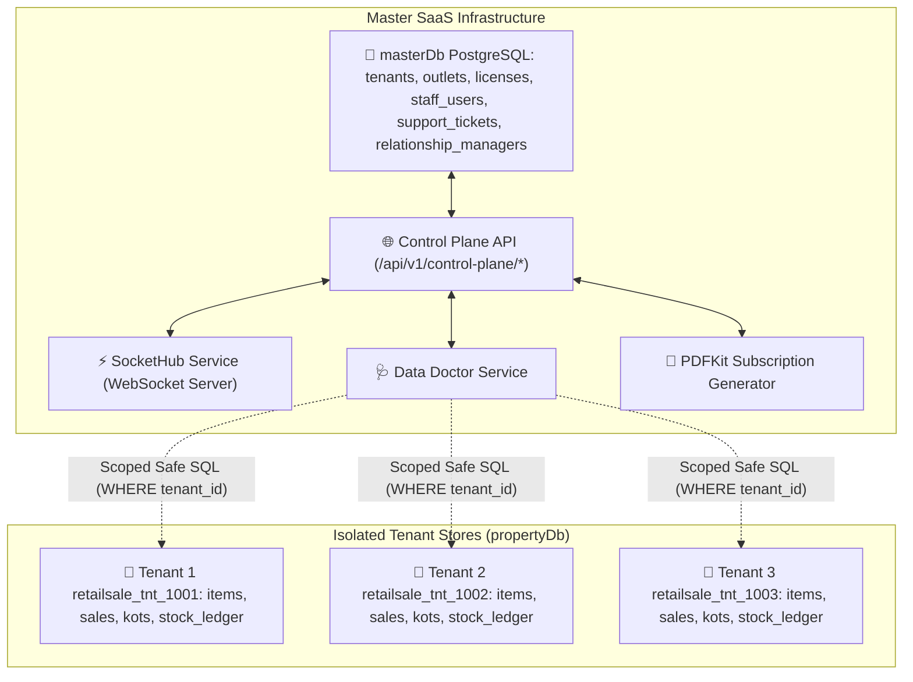
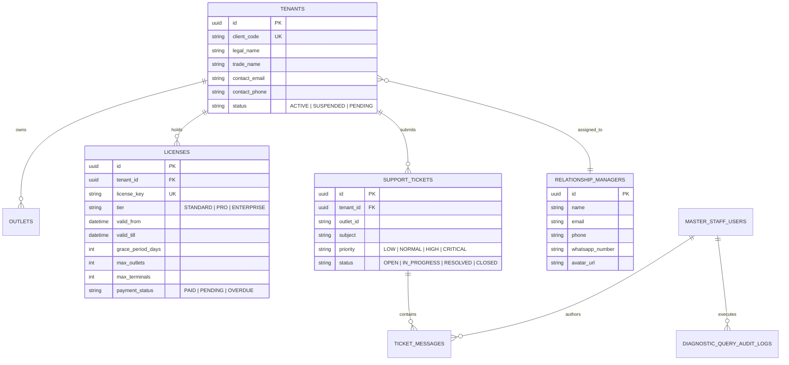

# Developer Guide: Famalth Lynx Enterprise SaaS Control Plane, Data Doctor & Multi-Tenant Architecture

This guide provides deep technical documentation for software engineers, backend developers, and systems architects working on the **Famalth Lynx Enterprise SaaS Control Plane**, **Multi-Tenant Fleet Engine**, **Diagnostic Data Doctor**, and **Subscription PDF Invoicing Pipeline**.

---

## 📑 Table of Contents
1. [Architectural Overview & Dual-Database Design](#1-architectural-overview--dual-database-design)
2. [IAM Authentication & Role-Based Middleware](#2-iam-authentication--role-based-middleware)
3. [Master Database Schemas & Entity Relationships](#3-master-database-schemas--entity-relationships)
4. [Control Plane REST API Reference](#4-control-plane-rest-api-reference)
5. [Sandboxed Data Doctor & Diagnostic Query Engine](#5-sandboxed-data-doctor--diagnostic-query-engine)
6. [Dynamic Migration Schema Extractor](#6-dynamic-migration-schema-extractor)
7. [Subscription Vector PDF Invoicing Engine](#7-subscription-vector-pdf-invoicing-engine)
8. [Real-Time WebSockets Hub (`socketHub.service.ts`)](#8-real-time-websockets-hub-sockethubservicets)
9. [Flutter Enterprise Console & Windows Inno Setup Packaging](#9-flutter-enterprise-console--windows-inno-setup-packaging)
10. [Testing & Verification Commands](#10-testing--verification-commands)

---

## 1. Architectural Overview & Dual-Database Design

The Famalth Lynx system uses a **Dual-Database Multi-Tenant Architecture**:



### Core Design Principles:
- **Tenant Isolation**: Every client organization maintains their operational data in their assigned schema or database (`propertyDb`).
- **Master Registry**: `masterDb` coordinates metadata across all organizations: client registration, license validation, RM assignments, and support communications.
- **Air-Gapped POS Resilience**: Individual POS terminals communicate with `masterDb` via lightweight polling/heartbeats (`/api/v1/control-plane/license-and-rm-status`). If internet connectivity drops, local POS billing is uninterrupted.

---

## 2. IAM Authentication & Role-Based Middleware

All administrative access to the Control Plane is enforced through dedicated middleware in `backend/middlewares/controlPlaneAuth.middleware.ts`.

### Middleware Stack:
1. `requireControlPlaneAuth`:
   - Extracts the JWT bearer token from the `Authorization: Bearer <token>` header.
   - Verifies the signature using `process.env.CONTROL_PLANE_JWT_SECRET || process.env.JWT_SECRET`.
   - Checks if the user is an active record in `master_staff_users`.
   - Attaches `req.staffUser` to the request object.
2. `requireStaffRole(allowedRoles: string[])`:
   - Validates that `req.staffUser.role` is included in the authorized role list.
   - Rejects unauthorized access with `403 Forbidden` (`INSUFFICIENT_PERMISSIONS`).

```typescript
// backend/middlewares/controlPlaneAuth.middleware.ts
export const requireStaffRole = (allowedRoles: string[]) => {
  return (req: any, res: any, next: any) => {
    if (!req.staffUser) {
      return res.status(401).json({ success: false, message: 'Unauthenticated staff member' });
    }
    if (!allowedRoles.includes(req.staffUser.role)) {
      return res.status(403).json({
        success: false,
        message: `Forbidden. Role '${req.staffUser.role}' is not authorized to perform this operation.`
      });
    }
    next();
  };
};
```

---

## 3. Master Database Schemas & Entity Relationships

The `masterDb` registry contains 8 core models managed via Sequelize in `backend/models/master/`:



---

## 4. Control Plane REST API Reference

All routes are mounted at `/api/v1/control-plane` via `backend/routes/control_plane.routes.ts`.

### 1. Authentication & Setup Bootstrap
- `GET /api/v1/control-plane/auth/setup-status`:
  - Returns `{ isInitialized: boolean, ownerCount: number }`.
- `POST /api/v1/control-plane/auth/initialize-master`:
  - Request: `{ full_name, email, password, setup_pin }`.
  - Creates the initial `SUPER_ADMIN` account on fresh installations.
- `POST /api/v1/control-plane/auth/login`:
  - Request: `{ email, password }`.
  - Response: `{ token, staffUser: { id, full_name, email, role, reseller_id } }`.

### 2. Fleet Overview & Governance
- `GET /api/v1/control-plane/fleet/overview`:
  - Returns aggregated counts: `totalTenants`, `activeTenants`, `totalOutlets`, `expiringLicensesCount`, `openTicketsCount`, `monthlyRecurringRevenue`.
- `GET /api/v1/control-plane/tenants`:
  - Query Params: `?page=1&limit=25&status=ACTIVE&search=cafe`.
  - Returns paginated list of tenants with nested licenses, outlets, and assigned RM details.
- `PATCH /api/v1/control-plane/tenants/:id/status`:
  - Request: `{ status: 'ACTIVE' | 'SUSPENDED' }`.
  - Triggers instant cache eviction and socket broadcast.
- `POST /api/v1/control-plane/tenants/:tenantId/assign-rm`:
  - Request: `{ relationship_manager_id }`.

### 3. Licensing, 30-Day Quota & Invoicing
- `POST /api/v1/control-plane/tenants/:tenantId/modify-license`:
  - Request: `{ tier, valid_till, max_terminals, max_outlets, grace_period_days }`.
- `POST /api/v1/control-plane/licenses/approve-payment/:tenantId`:
  - Request: `{ months_to_extend, payment_reference, payment_mode, amount_paid }`.
  - Extends `valid_till`, marks payment as `PAID`, generates a new vector PDF invoice.
- `GET /api/v1/control-plane/license-and-rm-status`:
  - Public heartbeat endpoint called by client POS terminals.
  - Returns `{ daysLeft, warningZone, warningLevel, validTill, gracePeriodDays, rmData, supportAgent }`.
- `GET /api/v1/control-plane/invoices/download/:tenantId`:
  - Returns streaming binary `application/pdf` vector invoice generated via `subscriptionInvoicePdf.service.ts`.
- `GET /api/v1/control-plane/renewals/export`:
  - Returns downloadable CSV spreadsheet of all renewals and overdue accounts.

### 4. Support Helpdesk & Live Chat
- `POST /api/v1/control-plane/support/tickets`:
  - Request: `{ tenant_id, outlet_id, subject, description, priority, category }`.
- `GET /api/v1/control-plane/support/tickets/:id`:
  - Returns ticket details with chronological `ticket_messages`.
- `POST /api/v1/control-plane/support/tickets/:id/messages`:
  - Request: `{ message, attachments, sender_type: 'STAFF' | 'CLIENT' }`.
  - Broadcasts message instantly over WebSocket to active listeners.
- `POST /api/v1/control-plane/support/tickets/:id/resolve`:
  - Request: `{ resolution_notes }`. Marks status as `RESOLVED`.

---

## 5. Sandboxed Data Doctor & Diagnostic Query Engine

The **Data Doctor** (`backend/services/dataDoctor.service.ts`) enables secure operational troubleshooting without providing full database superuser credentials.

### Security & Isolation Pipeline:
```
[Staff User Query Input]
           │
           ▼
[1. SQL Keyword Sanitizer] ──> Blocks DROP, TRUNCATE, ALTER, GRANT, REVOKE
           │
           ▼
[2. Tenant Context Binding] ──> Connects strictly to target tenant's propertyDb
           │
           ▼
[3. Execution & Timeout Cap] ──> Enforces 5,000ms query timeout & 500-row limit
           │
           ▼
[4. Audit Logging] ───────────> Writes to diagnostic_query_audit_logs
```

### Audit Log Schema (`diagnostic_query_audit_logs`):
```sql
CREATE TABLE diagnostic_query_audit_logs (
    id UUID PRIMARY KEY DEFAULT gen_random_uuid(),
    staff_user_id UUID NOT NULL,
    staff_name VARCHAR(150),
    tenant_id UUID NOT NULL,
    outlet_id VARCHAR(50),
    raw_query TEXT NOT NULL,
    execution_time_ms INTEGER NOT NULL,
    rows_affected INTEGER DEFAULT 0,
    status VARCHAR(20) NOT NULL, -- 'SUCCESS' | 'ERROR'
    error_message TEXT,
    created_at TIMESTAMP WITH TIME ZONE DEFAULT NOW()
);
```

---

## 6. Dynamic Migration Schema Extractor

Located at `backend/utils/migrationSchemaExtractor.ts`, this utility reads live database schemas and translates them into documentation dictionaries and migration recipes:

```typescript
// backend/utils/migrationSchemaExtractor.ts
export async function extractTenantDatabaseSchema(sequelizeInstance: any): Promise<MigrationSchemaResult> {
  const [columns] = await sequelizeInstance.query(`
    SELECT 
      table_name, 
      column_name, 
      data_type, 
      is_nullable,
      column_default
    FROM information_schema.columns
    WHERE table_schema = 'public'
    ORDER BY table_name, ordinal_position;
  `);
  // Groups into structured domains (Sales, Inventory, KOT, Finance)
  return formatSchemaDomains(columns);
}
```

The Flutter application consumes this metadata in `lib/screens/settings/data_dictionary_helper.dart` to provide autocomplete suggestions and domain search inside the Data Doctor studio.

---

## 7. Subscription Vector PDF Invoicing Engine

`backend/services/subscriptionInvoicePdf.service.ts` uses `pdfkit` to generate crisp, print-ready vector PDF subscription invoices.

### Highlights:
- **Zero Resolution Degradation**: Uses vector line drawing, custom fonts (`assets/fonts/Roboto-Regular.ttf`, `Roboto-Bold.ttf`), and precision millimeter coordinates.
- **Dynamic Currency Localization**: Automatically matches currency symbols (`₹`, `$`, `€`, `£`, `KSh`) based on tenant region and licensing profile.
- **Tax Breakdown**: Automatically computes SAC code 997331 (Software Licensing Service) with CGST/SGST or IGST depending on interstate status.

---

## 8. Real-Time WebSockets Hub (`socketHub.service.ts`)

`backend/services/socketHub.service.ts` maintains a bidirectional WebSocket cluster:
- **Room Subscriptions**:
  - `tenant:<tenantId>`: Pushes license status changes, quota warnings, and broadcast announcements.
  - `ticket:<ticketId>`: Streams live chat messages between store cashiers and central support staff.
  - `fleet:overview`: Broadcasts real-time tenant activations and MRR recalculations to the Control Plane overview dashboard.

---

## 9. Flutter Enterprise Console & Windows Inno Setup Packaging

The administrative interface is compiled as a standalone desktop utility:
- **Entry Point**: `lib/main_control_plane.dart`
- **Build Script**: `build_enterprise_console.bat`
- **Installer Script**: `installer/enterprise_control_plane.iss`

### Compilation Command:
```bat
:: Build release Flutter executable for Windows
flutter build windows --target=lib/main_control_plane.dart --release

:: Compile Inno Setup Installer
iscc "installer\enterprise_control_plane.iss"
```
The resulting executable is generated at `build\windows\installer\FamalthLynx-ControlPlane-Setup.exe`.

---

## 10. Testing & Verification Commands

### 1. Test Control Plane Setup Bootstrap Status:
```bash
curl -X GET http://localhost:5000/api/v1/control-plane/auth/setup-status
```

### 2. Test Client License & RM Heartbeat:
```bash
curl -X GET http://localhost:5000/api/v1/control-plane/license-and-rm-status \
  -H "X-Tenant-Code: TNT-1001"
```

### 3. Verify Diagnostic Error Analyzer:
```bash
curl -X POST http://localhost:5000/api/v1/control-plane/support/analyze-error \
  -H "Authorization: Bearer <SUPER_ADMIN_JWT>" \
  -H "Content-Type: application/json" \
  -d '{"errorMessage": "duplicate key value violates unique constraint sales_headers_invoice_no_key"}'
```
