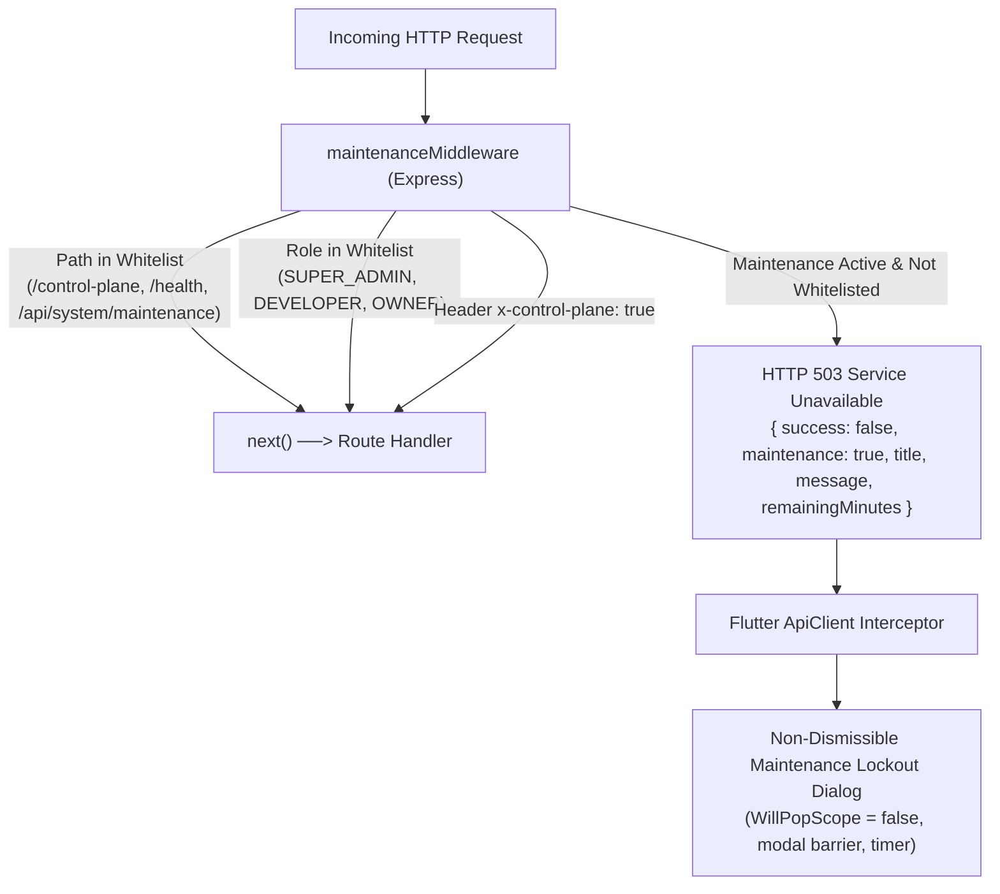

# Developer Guide: System Maintenance Mode & Non-Dismissible Lockout Architecture

This document provides deep technical details on the **Maintenance Middleware Engine**, **Atomic State Persistence**, **Role-Based Whitelist Bypasses**, and the **Flutter Client Interceptor Pipeline** (`ApiClient.showMaintenanceLockoutDialog`).

---

## 📑 Table of Contents
1. [Architecture Overview & Interception Pipeline](#1-architecture-overview--interception-pipeline)
2. [Maintenance Middleware Implementation (`maintenance.middleware.ts`)](#2-maintenance-middleware-implementation-maintenancemiddlewarets)
3. [Whitelist Exemption Matrix & Role Bypass Rules](#3-whitelist-exemption-matrix--role-bypass-rules)
4. [Atomic State Storage (`maintenance_state.json` & `maintenance.service.ts`)](#4-atomic-state-storage-maintenance_statejson--maintenanceservicets)
5. [Maintenance REST API Reference](#5-maintenance-rest-api-reference)
6. [Flutter Client Interceptor & Non-Dismissible Dialog](#6-flutter-client-interceptor--non-dismissible-dialog)
7. [Testing & Verification Commands](#7-testing--verification-commands)

---

## 1. Architecture Overview & Interception Pipeline



---

## 2. Maintenance Middleware Implementation (`maintenance.middleware.ts`)

Located in `backend/middlewares/maintenance.middleware.ts`:

```typescript
export function maintenanceMiddleware(req: Request, res: Response, next: NextFunction) {
  const fullPath = (req.originalUrl || req.baseUrl + req.path || req.path || '').toLowerCase();

  // 1. Whitelist Static & Essential Endpoints
  if (
    fullPath.includes('/control-plane') ||
    fullPath.includes('/api/system/maintenance') ||
    fullPath.includes('/api/backup') ||
    fullPath.includes('/api/auth/login') ||
    fullPath.includes('/health') ||
    fullPath.includes('/canvaskit') ||
    fullPath.includes('/assets') ||
    req.headers['x-client-type'] === 'enterprise-console' ||
    req.headers['x-control-plane'] === 'true' ||
    req.method === 'OPTIONS'
  ) {
    return next();
  }

  // 2. Role-Based Bypass via Decoded JWT or Req User
  const user = (req as any).user;
  const role = String(user?.role || '').toUpperCase();
  const allowedBypassRoles = [
    'SUPER_ADMIN', 'ENTERPRISE_ADMIN', 'OWNER', 
    'DEVELOPER', 'RESELLER_ADMIN', 'RESELLER', 'SUPPORT_AGENT', 'RM'
  ];

  if (allowedBypassRoles.includes(role)) {
    return next();
  }

  // 3. Fallback JWT Header Inspection (Pre-Auth Routes)
  const authHeader = req.headers.authorization;
  if (authHeader && authHeader.startsWith('Bearer ')) {
    try {
      const decoded = jwt.verify(authHeader.split(' ')[1]);
      const tokenRole = String(decoded?.role || '').toUpperCase();
      if (decoded?.is_control_plane === true || allowedBypassRoles.includes(tokenRole)) {
        return next();
      }
    } catch (_) {}
  }

  // 4. Return HTTP 503 if under active maintenance
  if (maintenanceService.isUnderMaintenance()) {
    const status = maintenanceService.getStatus();
    return res.status(503).json({
      success: false,
      maintenance: true,
      title: status.title,
      message: status.message,
      startedAt: status.startedAt,
      estimatedEndTime: status.estimatedEndTime,
      remainingMinutes: status.remainingMinutes,
    });
  }

  return next();
}
```

---

## 3. Whitelist Exemption Matrix & Role Bypass Rules

| Request Type / Role | Access Status During Maintenance | Reason |
| :--- | :--- | :--- |
| **Store Cashier / POS Billing** | 🔴 **BLOCKED (503 Lockout)** | Prevents writing sales to database while schema or sync is executing. |
| **Floor Captain / Waiter KOT** | 🔴 **BLOCKED (503 Lockout)** | Prevents creating new kitchen orders during migration. |
| **Customer QR Self-Ordering** | 🔴 **BLOCKED (503 Notice)** | Displays maintenance message on mobile browser. |
| **Control Plane Staff / SuperAdmin** | 🟢 **ALLOWED (Bypass)** | Needed to execute migrations, inspect logs, and manage tenants. |
| **Health Checks (`/health`)** | 🟢 **ALLOWED (Bypass)** | Load balancers (Render, AWS, Nginx) do not kill backend containers. |
| **Static Assets (`/canvaskit`, `/assets`)** | 🟢 **ALLOWED (Bypass)** | Browser clients must load UI assets for modal display. |

---

## 4. Atomic State Storage (`maintenance_state.json` & `maintenance.service.ts`)

Maintenance state is persisted in an atomic JSON file `backend/maintenance_state.json` so state survives Node.js process crashes, server restarts, or PM2 reloads:

```json
{
  "isActive": false,
  "title": "System Under Scheduled Maintenance",
  "message": "System maintenance is active. Store operations are temporarily paused.",
  "startedAt": null,
  "durationMinutes": 30,
  "activatedBy": "Super Admin",
  "advanceNoticeActive": false,
  "scheduledStartTime": null,
  "scheduledDurationMinutes": 60,
  "noticeTitle": "Upcoming Scheduled Maintenance",
  "noticeMessage": "System maintenance scheduled for tonight."
}
```

### Automatic Expiry Computation:
`maintenanceService.isUnderMaintenance()` automatically checks if the current timestamp has surpassed `startedAt + durationMinutes`. If time has elapsed, maintenance automatically disengages without requiring manual operator intervention.

---

## 5. Maintenance REST API Reference

Mounted on `/api/system/*` in `backend/routes/system.routes.ts`:

### 1. Get Public Maintenance Status
```http
GET /api/system/maintenance-status
```
Returns `{ success: true, data: { isActive, title, message, remainingMinutes, advanceNoticeActive } }`.

### 2. Set Active Maintenance Mode
```http
POST /api/system/maintenance
Authorization: Bearer <SUPER_ADMIN_JWT>
Content-Type: application/json

{
  "isActive": true,
  "title": "Database Index Rebuild",
  "message": "Upgrading database indexes. Operations will resume in 15 minutes.",
  "durationMinutes": 15
}
```

### 3. Set Advance Notice Banner
```http
POST /api/system/maintenance/advance-notice
Authorization: Bearer <SUPER_ADMIN_JWT>
Content-Type: application/json

{
  "advanceNoticeActive": true,
  "scheduledStartTime": "2026-10-26T23:30:00Z",
  "scheduledDurationMinutes": 30,
  "noticeTitle": "Scheduled Cloud Maintenance",
  "noticeMessage": "Maintenance tonight from 11:30 PM to 12:00 AM."
}
```

---

## 6. Flutter Client Interceptor & Non-Dismissible Dialog

In `lib/core/api/api_client.dart`:

```dart
// ApiClient Interceptor snippet
if (response.statusCode == 503 || (data is Map && data['maintenance'] == true)) {
  final title = (data is Map ? data['title'] : null) ?? 'System Under Scheduled Maintenance';
  final message = (data is Map ? data['message'] : null) ?? 'Store operations are temporarily paused.';
  final remainingMinutes = data is Map ? (data['remainingMinutes'] ?? 0) : 0;

  showMaintenanceLockoutDialog(
    title: title.toString(),
    message: message.toString(),
    remainingMinutes: remainingMinutes is int ? remainingMinutes : 0,
  );

  return { 'success': false, 'maintenance': true };
}
```

### Non-Dismissible Dialog Properties:
- `barrierDismissible: false`: Tapping outside the modal has zero effect.
- `PopScope(canPop: false)`: Intercepts Android hardware back button and Windows Alt+F4 / Escape keys.
- **Background Periodic Poller**: Every 10 seconds, calls `/api/system/maintenance-status`. As soon as `isActive == false`, sets `_isMaintenanceDialogOpen = false` and pops the dialog.

---

## 7. Testing & Verification Commands

### Test Activating Maintenance Mode:
```bash
curl -X POST http://localhost:5000/api/system/maintenance \
  -H "Authorization: Bearer <SUPER_ADMIN_JWT>" \
  -H "Content-Type: application/json" \
  -d '{"isActive": true, "durationMinutes": 10, "message": "Automated verification test"}'
```

### Test Cashier Endpoint Receiving 503:
```bash
curl -i -X GET http://localhost:5000/api/items \
  -H "Authorization: Bearer <CASHIER_JWT>"
```
*Expected: HTTP/1.1 503 Service Unavailable with `maintenance: true`.*

### Test Disabling Maintenance Mode:
```bash
curl -X POST http://localhost:5000/api/system/maintenance \
  -H "Authorization: Bearer <SUPER_ADMIN_JWT>" \
  -H "Content-Type: application/json" \
  -d '{"isActive": false}'
```
