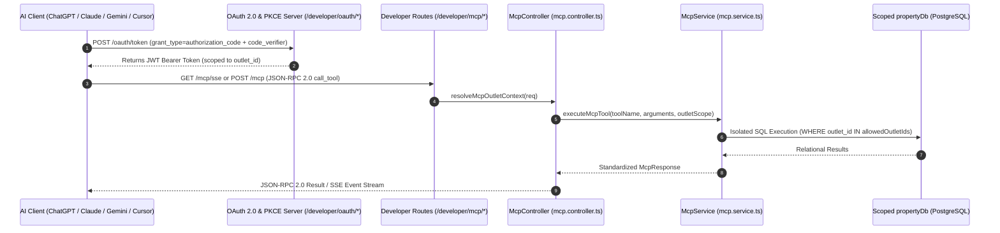

# Developer Guide: Model Context Protocol (MCP) & AI Gateway Architecture (ChatGPT, Claude, Gemini, Cursor)

This document provides deep technical specifications for backend engineers, AI system architects, and full-stack developers on the **Model Context Protocol (MCP)**, **OAuth 2.0 RFC 6749 / RFC 7636 (PKCE)**, **OpenAPI 3.0 ChatGPT Spec Generator**, **Gemini Function Calling Specs**, and the **Remote SSE / JSON-RPC 2.0 Transport Engine** in Famalth Lynx.

---

## 📑 Table of Contents
1. [Architecture Overview & AI Communication Flow](#1-architecture-overview--ai-communication-flow)
2. [OAuth 2.0 & RFC 8414 Discovery Server](#2-oauth-20--rfc-8414-discovery-server)
3. [Multi-Tenant Outlet Resolution & Scoping Guard (`resolveMcpOutletContext`)](#3-multi-tenant-outlet-resolution--scoping-guard-resolvemcpoutletcontext)
4. [Supported Transport Protocols: SSE & JSON-RPC 2.0](#4-supported-transport-protocols-sse--json-rpc-20)
5. [Complete MCP Tool Specifications](#5-complete-mcp-tool-specifications)
   - [Tool 1: `analyze_sales`](#tool-1-analyze_sales)
   - [Tool 2: `create_order_bill`](#tool-2-create_order_bill)
   - [Tool 3: `get_inventory_status`](#tool-3-get_inventory_status)
   - [Tool 4: `search_products`](#tool-4-search_products)
   - [Tool 5: `get_order_details`](#tool-5-get_order_details)
   - [Tool 6: `get_customer_insights`](#tool-6-get_customer_insights)
6. [Dynamic Spec Generators (ChatGPT OpenAPI & Gemini Function Declarations)](#6-dynamic-spec-generators-chatgpt-openapi--gemini-function-declarations)
7. [REST API Endpoint Specifications (`/api/v1/developer/*`)](#7-rest-api-endpoint-specifications-apiv1developer)
8. [Testing & Verification Commands](#8-testing--verification-commands)

---

## 1. Architecture Overview & AI Communication Flow

The MCP Gateway subsystem in Famalth Lynx connects Large Language Models to the relational store database while maintaining zero cross-tenant leakage:



---

## 2. OAuth 2.0 & RFC 8414 Discovery Server

To allow OpenAI Custom GPTs and standard OAuth clients to authenticate without hardcoded secrets, Famalth Lynx implements standard RFC 6749 and RFC 7636:

### Endpoints:
1. `GET /api/v1/developer/.well-known/oauth-authorization-server`:
   - Returns RFC 8414 discovery JSON metadata:
   ```json
   {
     "issuer": "https://famalth-lynx-pos.onrender.com",
     "authorization_endpoint": "https://famalth-lynx-pos.onrender.com/api/v1/developer/oauth/authorize",
     "token_endpoint": "https://famalth-lynx-pos.onrender.com/api/v1/developer/oauth/token",
     "token_endpoint_auth_methods_supported": ["client_secret_basic", "client_secret_post"],
     "response_types_supported": ["code"],
     "grant_types_supported": ["authorization_code", "client_credentials", "refresh_token"],
     "code_challenge_methods_supported": ["S256", "plain"],
     "scopes_supported": [
       "orders:read",
       "orders:write",
       "billing:read",
       "reports:read",
       "inventory:read"
     ],
     "service_documentation": "https://famalth-lynx-pos.onrender.com/api/v1/developer/ecosystem/info"
   }
   ```
2. `GET/POST /api/v1/developer/oauth/authorize`:
   - Validates `client_id`, issues authorization code (`lynx_auth_xxxxxxxx`), and redirects back to `redirect_uri` with `code` and `state`.
3. `POST /api/v1/developer/oauth/token`:
   - Supports `grant_type=authorization_code` with PKCE `code_verifier` validation.
   - Supports `grant_type=client_credentials` with HTTP Basic Auth (`Authorization: Basic <base64>`) or request body credentials.
   - Issues a scoped JWT access token (24-hour TTL) and refresh token (30-day TTL).

---

## 3. Multi-Tenant Outlet Resolution & Scoping Guard (`resolveMcpOutletContext`)

Located in `backend/controllers/mcp.controller.ts`:
Every AI request must pass through `resolveMcpOutletContext`:
```typescript
export async function resolveMcpOutletContext(db: any, req: any): Promise<McpOutletContext> {
    // 1. Inspect X-API-Key Header or Query Param
    // 2. Inspect Bearer JWT Token (sub, outlet_id, scopes)
    // 3. Query linked_outlets cluster if the outlet is a Master Headquarter
    // 4. Returns strict allowedOutletIds whitelist
}
```

### Security Policy:
- If an AI model invokes a tool with `arguments.outletId`, the system validates:
  $$\text{targetOutletId} \in \text{context.allowedOutletIds}$$
- If an unauthorized outlet ID is requested, the system rejects execution with:
  `Error: Outlet #X is not within your authorized cluster (Allowed: Outlet #1, #2).`

---

## 4. Supported Transport Protocols: SSE & JSON-RPC 2.0

Famalth Lynx supports both standard Model Context Protocol transports:

### 1. Server-Sent Events (SSE) Remote Transport (`GET /api/v1/developer/mcp/sse`)
- Keeps an open HTTP streaming connection (`Content-Type: text/event-stream`).
- Sends the initial endpoint URI event:
  ```text
  event: endpoint
  data: /api/v1/developer/mcp/messages?sessionId=xxxxxxxx
  ```
- Client sends JSON-RPC 2.0 commands via `POST /api/v1/developer/mcp/messages?sessionId=xxxxxxxx`.

### 2. Standard JSON-RPC 2.0 over HTTP (`POST /api/v1/developer/mcp`)
- Implements standard MCP methods:
  - `initialize`: Returns protocol version (`2024-11-05`), server capabilities, and branding info.
  - `tools/list`: Returns all 6 available tool schemas.
  - `tools/call`: Executes the target tool and returns `{ content: [{ type: 'text', text: ... }] }`.

---

## 5. Complete MCP Tool Specifications

Implemented in `backend/services/mcp.service.ts`:

### Tool 1: `analyze_sales`
- **Purpose**: Computes gross sales, net revenue, discounts, taxes, invoice count, average order value (AOV), payment method splits, hourly peak sales, and top-selling items.
- **Parameters**:
  - `timeframe`: `today` | `yesterday` | `this_week` | `last_7_days` | `this_month` | `last_month` | `custom`.
  - `startDate`, `endDate`: `YYYY-MM-DD` (for custom range).
  - `groupBy`: `day` | `payment_mode` | `hourly` | `top_items`.
  - `outletId`: Target outlet.

### Tool 2: `create_order_bill`
- **Purpose**: Creates an atomic sales order in `sales_headers` and `sales_items`, updates `stock_ledger`, logs cash/bank balances, and outputs a formatted POS receipt text.
- **Parameters**:
  - `customerName`: string.
  - `customerPhone`: string.
  - `paymentMode`: `CASH` | `UPI` | `CARD` | `CREDIT` | `SPLIT`.
  - `items`: Array of `{ name, quantity, unitPrice?, itemCode?, barcode?, discount? }`.
  - `discountAmount`: Overall bill discount.
  - `notes`: e.g. `Order generated via ChatGPT Assistant`.
  - `outletId`: Target outlet.

### Tool 3: `get_inventory_status`
- **Purpose**: Checks live stock balances, calculates total inventory valuation (cost vs retail), and lists items below threshold.
- **Parameters**:
  - `filter`: `all` | `low_stock` | `out_of_stock`.
  - `threshold`: Low-stock warning threshold (default: 10).
  - `search`: Keyword filter.
  - `limit`: Integer (default: 50, max: 200).

### Tool 4: `search_products`
- **Purpose**: Searches `item_master` by product name, SKU, barcode, or category keyword.
- **Parameters**:
  - `query`: Keyword string.
  - `limit`: Maximum items to return (default: 20).

### Tool 5: `get_order_details`
- **Purpose**: Retrieves complete itemized invoice information.
- **Parameters**:
  - `billNumber`: e.g. `BILL_1042`.
  - `orderId`: Numeric primary key.

### Tool 6: `get_customer_insights`
- **Purpose**: Calculates customer RFM (Recency, Frequency, Monetary) metrics, lifetime orders, total spend, and unpaid credit balances.
- **Parameters**:
  - `phone`: Mobile number.
  - `name`: Customer name search fallback.

---

## 6. Dynamic Spec Generators (ChatGPT OpenAPI & Gemini Function Declarations)

The server automatically compiles and serves runtime specs dynamically matched to the server's current host domain and SSL protocol:

1. **ChatGPT OpenAPI 3.0 Spec** (`GET /api/v1/developer/mcp/chatgpt-openapi.json`):
   - Dynamically resolves `servers: [{ url: "https://<current-host>/api/v1/developer" }]`.
   - Defines OpenAPI paths for `/mcp/tools/analyze-sales`, `/create-order-bill`, `/inventory-status`, and `/search-products`.
   - Defines `securitySchemes` supporting both `OAuth2` (Authorization Code + PKCE) and `ApiKeyAuth` (Custom header `X-API-Key`).
   - Enables instant 1-click import into ChatGPT GPT Builder under **Actions** $\rightarrow$ **Import from URL**.
2. **Gemini Function Calling Spec** (`GET /api/v1/developer/mcp/gemini-tools.json`):
   - Formats tools into the Google Generative AI SDK function declaration schema (`functionDeclarations: [...]`).
   - Compatible with Google AI Studio, Vertex AI, and Gemini Live API.

---

## 7. REST API Endpoint Specifications (`/api/v1/developer/*`)

Mounted on `/api/v1/developer` via `backend/routes/developer.routes.ts`:

### API Keys & OAuth
- `GET /api/v1/developer/api-keys` — List active developer credentials.
- `POST /api/v1/developer/api-keys` — Issue new API Key & Client Secret.
- `DELETE /api/v1/developer/api-keys/:id` — Revoke developer credentials.
- `GET/POST /api/v1/developer/oauth/authorize` — OAuth 2.0 authorization code issuance.
- `POST /api/v1/developer/oauth/token` — OAuth 2.0 token exchange (code exchange & client credentials).
- `GET /api/v1/developer/.well-known/oauth-authorization-server` — RFC 8414 server metadata.

### Model Context Protocol (MCP) Transports
- `POST /api/v1/developer/mcp` — Standard JSON-RPC 2.0 endpoint.
- `GET /api/v1/developer/mcp/sse` — Server-Sent Events stream for remote MCP clients.
- `POST /api/v1/developer/mcp/messages` — SSE message delivery endpoint.
- `GET /api/v1/developer/mcp/tools` — JSON list of all available tool schemas.
- `GET /api/v1/developer/mcp/config` — Server diagnostics, uptime, and MCP capabilities.
- `GET /api/v1/developer/mcp/chatgpt-openapi.json` — OpenAPI 3.0 specification for Custom GPTs.
- `GET /api/v1/developer/mcp/gemini-tools.json` — Google Gemini tool calling declarations.

### Direct Action Endpoints
- `POST /api/v1/developer/mcp/tools/execute` — Execute any tool directly by name.
- `POST /api/v1/developer/mcp/tools/analyze-sales` — Direct sales analytics execution.
- `POST /api/v1/developer/mcp/tools/create-order-bill` — Direct POS order billing.
- `POST /api/v1/developer/mcp/tools/inventory-status` — Direct stock status execution.
- `POST /api/v1/developer/mcp/tools/search-products` — Direct product search.

---

## 8. Testing & Verification Commands

### 1. Test JSON-RPC 2.0 Tool Listing:
```bash
curl -X POST http://localhost:5000/api/v1/developer/mcp \
  -H "X-API-Key: YOUR_LYNX_API_KEY" \
  -H "Content-Type: application/json" \
  -d '{
    "jsonrpc": "2.0",
    "id": 1,
    "method": "tools/list"
  }'
```

### 2. Test JSON-RPC 2.0 Tool Call (`analyze_sales`):
```bash
curl -X POST http://localhost:5000/api/v1/developer/mcp \
  -H "X-API-Key: YOUR_LYNX_API_KEY" \
  -H "Content-Type: application/json" \
  -d '{
    "jsonrpc": "2.0",
    "id": 2,
    "method": "tools/call",
    "params": {
      "name": "analyze_sales",
      "arguments": {
        "timeframe": "today"
      }
    }
  }'
```

### 3. Test OAuth 2.0 Token Generation via Client Credentials:
```bash
curl -X POST http://localhost:5000/api/v1/developer/oauth/token \
  -H "Content-Type: application/json" \
  -d '{
    "grant_type": "client_credentials",
    "client_id": "YOUR_CLIENT_ID",
    "client_secret": "YOUR_CLIENT_SECRET"
  }'
```

### 4. Test Remote SSE Connection:
```bash
curl -N -H "X-API-Key: YOUR_LYNX_API_KEY" http://localhost:5000/api/v1/developer/mcp/sse
```
*Expected: Streams `event: endpoint` with unique session callback URL.*
