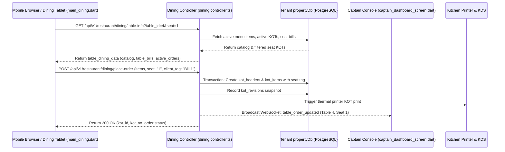

# Developer Guide: Contactless QR Dining Portal, Multi-Seat & Split-Bill Architecture

This guide covers the technical architecture, data schemas, REST APIs, and state management for the **Contactless Dining Portal**, **Multi-Seat / Split-Bill Engine**, and **Standalone Customer Tablet App** (`lib/main_dining.dart`).

---

## 📑 Table of Contents
1. [Architecture & System Flow](#1-architecture--system-flow)
2. [Data Models & Schema Enhancements (Seat, Client Tag, Sub-Table)](#2-data-models--schema-enhancements-seat-client-tag-sub-table)
3. [Dining REST API Reference](#3-dining-rest-api-reference)
4. [Combined vs Per-Seat Bill Calculation Engine](#4-combined-vs-per-seat-bill-calculation-engine)
5. [Standalone Dining Application Architecture (`lib/main_dining.dart`)](#5-standalone-dining-application-architecture-libmain_diningdart)
6. [Modifiers & Customization Pipeline](#6-modifiers--customization-pipeline)
7. [Real-Time WebSocket & Captain Floor Sync](#7-real-time-websocket--captain-floor-sync)
8. [Testing & Verification](#8-testing--verification)

---

## 1. Architecture & System Flow



---

## 2. Data Models & Schema Enhancements (Seat, Client Tag, Sub-Table)

In `backend/models/restaurant/kot_headers.model.ts`, table orders accommodate multi-party group dining using three relational tags:

| Field Name | Type | Purpose | Example Value |
| :--- | :--- | :--- | :--- |
| `table_id` | `UUID / INT` | Foreign key referencing the physical table in `restaurant_tables`. | `4` |
| `seat` | `VARCHAR(50)` | Identifies the physical chair or position occupied by the diner. | `"Seat 1"`, `"Seat 2"` |
| `client_tag` | `VARCHAR(100)` | Grouping tag identifying the billing envelope. | `"Bill 1"`, `"Bill 2"`, `"Table Bill"` |
| `sub_table` | `VARCHAR(50)` | Sub-division descriptor displayed on KOT tickets and bills. | `"Seat 1"`, `"Table 4-B"` |
| `kottype` | `VARCHAR(10)` | Order category (`'g'` for General Dine-In, `'r'` for Room Service). | `'g'` |
| `status` | `VARCHAR(20)` | Workflow status (`'p'` Pending, `'Printed'`, `'Served'`, `'Billed'`). | `'p'` |

### KOT Revision Snapshot Schema:
Whenever a customer or waiter submits an order round, a snapshot is recorded in `kot_revisions`:
```typescript
{
  kot_header_id: kotHeader.id,
  revision_no: nextRevisionNumber,
  reason: 'Customer QR Self-Order Round',
  snapshot: {
    items: [
      { item_id: 104, item_name: 'Paneer Tikka', quantity: 2, rate: 260.00, modifiers: [...] }
    ],
    totalAmount: 520.00,
    seat: 'Seat 1',
    client_tag: 'Bill 1',
    sub_table: 'Seat 1',
    payment_method: 'PAY_LATER'
  }
}
```

---

## 3. Dining REST API Reference

Implemented in `backend/controllers/restaurant/dining.controller.ts` and mounted on `/api/v1/restaurant/dining/*`.

### 1. Fetch Table Dining Catalog & Active Orders
```http
GET /api/v1/restaurant/dining/table-info?outlet_id=1&table_id=4&seat=1&client_tag=Bill%201
```

#### Response Structure:
```json
{
  "success": true,
  "data": {
    "table": {
      "id": 4,
      "table_name": "Table 4 - AC",
      "capacity": 4,
      "status": "Occupied"
    },
    "categories": ["Starters", "Main Course", "Breads", "Beverages"],
    "items": [
      {
        "id": 102,
        "item_name": "Butter Chicken",
        "category_name": "Main Course",
        "rate": 380.00,
        "retail_sale_price": 380.00,
        "tax_percent": 5.0,
        "is_tax_inclusive": true,
        "image_url": "https://cdn.example.com/items/butter_chicken.jpg"
      }
    ],
    "active_orders": [
      {
        "kot_id": 892,
        "kot_no": "KOT-892",
        "seat": "Seat 1",
        "client_tag": "Bill 1",
        "status": "In Preparation",
        "created_at": "2026-10-21T13:45:00Z",
        "items": [...]
      }
    ],
    "table_bills": [
      {
        "client_tag": "Bill 1",
        "seat": "Seat 1",
        "subtotal": 520.00,
        "tax_amount": 26.00,
        "total_amount": 546.00
      }
    ],
    "table_bill": {
      "total_subtotal": 1280.00,
      "total_tax": 64.00,
      "grand_total": 1344.00
    }
  }
}
```

### 2. Place Customer Dining Order
```http
POST /api/v1/restaurant/dining/place-order
Content-Type: application/json

{
  "outlet_id": "1",
  "table_id": 4,
  "seat": "Seat 1",
  "client_tag": "Bill 1",
  "sub_table": "Seat 1",
  "customer_name": "Rahul Verma",
  "customer_phone": "9876543210",
  "customer_email": "rahul@example.com",
  "payment_method": "PAY_LATER",
  "special_instructions": "Less spicy, no coriander",
  "items": [
    {
      "item_id": 102,
      "quantity": 1,
      "rate": 380.00,
      "notes": "Extra gravy",
      "modifiers": [
        { "modifier_id": 12, "name": "Extra Butter", "rate": 30.00 }
      ]
    }
  ]
}
```

### 3. Settle / Pay Customer Dining Bill
```http
POST /api/v1/restaurant/dining/pay-bill
Content-Type: application/json

{
  "outlet_id": "1",
  "table_id": 4,
  "seat": "Seat 1",
  "client_tag": "Bill 1",
  "payment_mode": "UPI",
  "transaction_id": "UPI-TXN-998822"
}
```

---

## 4. Combined vs Per-Seat Bill Calculation Engine

In `dining.controller.ts`, orders are aggregated into both per-seat breakdowns and a master table total:

```typescript
// Grouping KOTs by Client Tag / Seat
const billsMap = new Map<string, { client_tag: string; seat: string; items: any[]; totalAmount: number }>();

for (const kot of allFormattedKots) {
  const key = kot.client_tag || kot.seat || 'General';
  if (!billsMap.has(key)) {
    billsMap.set(key, {
      client_tag: kot.client_tag || 'Bill 1',
      seat: kot.seat || 'Table',
      items: [],
      totalAmount: 0
    });
  }
  const group = billsMap.get(key)!;
  group.items.push(...kot.items);
  group.totalAmount += kot.total_amount;
}
const tableBills = Array.from(billsMap.values());
const tableBill = {
  total_amount: tableBills.reduce((acc, b) => acc + b.totalAmount, 0)
};
```

This architecture allows diners to pay for their individual seat tab or settle the entire table in a single step without database locking conflicts.

---

## 5. Standalone Dining Application Architecture (`lib/main_dining.dart`)

For tablet kiosks placed at every dining table, a dedicated Flutter entry point is provided:

```dart
// lib/main_dining.dart
void main() async {
  WidgetsFlutterBinding.ensureInitialized();
  await NotificationService.init();
  await AppConfig.init();

  runApp(
    MultiProvider(
      providers: [
        ChangeNotifierProvider(create: (_) => SystemSettingsController()..load()),
        ChangeNotifierProvider(create: (_) => ThemeController()..load()),
        ChangeNotifierProvider(create: (_) => UiPreferencesController()..load()),
        ChangeNotifierProvider(create: (_) => AppBrandingController()..loadLocal()),
        ChangeNotifierProvider(create: (_) => UserController()),
        ChangeNotifierProvider(create: (_) => BOMController()),
      ],
      child: const MyApp(homeWidget: DiningAppSplashScreen()),
    ),
  );
}
```

### Table Dining State Machine (`_TableDiningScreenState`):
- `_initializeDiningSession()`: Parses URL query parameters (`?table_id=4&seat=1`) or loads table configuration from local storage.
- `_fetchTableDiningCatalog()`: Calls `getTableDiningInfo` and populates category chips, search filters, and active bills.
- `_addItemToCart()` / `_removeItemFromCart()`: Maintains reactive in-memory cart with modifier calculations.
- `_callWaiter(String requestType)`: Sends instant assistance pings to Captain consoles.
- `_processOrderPlacement()`: Submits payload with optimistic UI locking.

---

## 6. Modifiers & Customization Pipeline

Items in the catalog can include customizable add-ons:
```dart
Future<void> _showModifiersDialog(Map<String, dynamic> item) async {
  // Renders options: Portions (Regular/Large), Addons (Extra Cheese, Mayo), Notes
  final selectedModifiers = await showDialog<List<Map<String, dynamic>>>(
    context: context,
    builder: (ctx) => DiningModifiersModal(item: item),
  );
  if (selectedModifiers != null) {
    _addItemToCart(item, modifiers: selectedModifiers);
  }
}
```
The modifier adjustments are factored into the unit rate, stored in `kot_items.notes`, and printed on kitchen tickets.

---

## 7. Real-Time WebSocket & Captain Floor Sync

When an order is created or status changes:
1. `dining.controller.ts` emits an event on the WebSocket hub:
   ```typescript
   socketHub.emitToOutlet(outlet_id, 'KOT_CREATED', {
     kot_id: kotHeader.id,
     table_id,
     table_name: table.table_name,
     seat: effectiveSeat,
     client_tag: effectiveClientTag
   });
   ```
2. The Captain Console (`captain_dashboard_screen.dart`) receives the event and triggers an audio ping:
   ```dart
   _socket.on('KOT_CREATED', (data) {
     _playOrderNotificationChime();
     _refreshTableTiles();
   });
   ```

---

## 8. Testing & Verification

### Test Placing a Multi-Seat Order via cURL:
```bash
curl -X POST http://localhost:5000/api/v1/restaurant/dining/place-order \
  -H "Content-Type: application/json" \
  -d '{
    "outlet_id": "1",
    "table_id": 4,
    "seat": "Seat 2",
    "client_tag": "Bill 2",
    "customer_name": "Sara Khan",
    "payment_method": "PAY_LATER",
    "items": [
      { "item_id": 105, "quantity": 1, "rate": 220.00 }
    ]
  }'
```

### Test Fetching Table Bill Breakdown:
```bash
curl -X GET "http://localhost:5000/api/v1/restaurant/dining/table-info?outlet_id=1&table_id=4"
```
Verify that `table_bills` contains separated entries for `Seat 1` and `Seat 2`, while `table_bill.grand_total` reflects the aggregate total.
