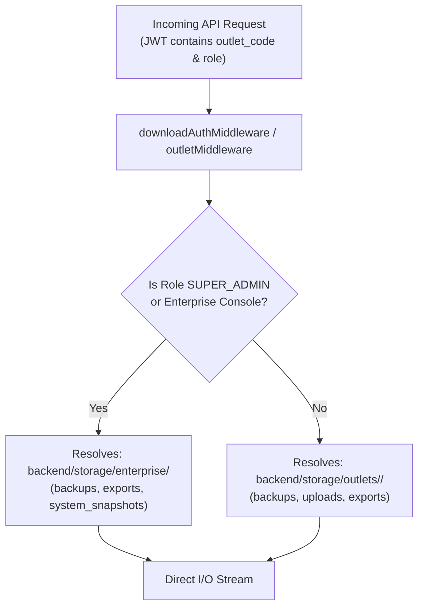

# Developer Guide: Multi-Tiered Storage Architecture, Outlet File Sandboxing & Backup Services

This technical guide provides architecture specifications, directory resolution routines, REST APIs, and file-format internals for the **Famalth Lynx Multi-Tiered Storage Volume** (`backend/storage/`), **Outlet Sandboxing Engine**, and **Automated Backup & Disaster Recovery Services**.

---

## 📑 Table of Contents
1. [Storage Architecture Overview & Security Invariants](#1-storage-architecture-overview--security-invariants)
2. [Volume Hierarchy & Directory Layout](#2-volume-hierarchy--directory-layout)
3. [Path Resolution Engine (`StorageQuotaService`)](#3-path-resolution-engine-storagequotaservice)
4. [Enterprise Tier vs Outlet Sandboxing](#4-enterprise-tier-vs-outlet-sandboxing)
5. [Backup Archive Formats (`.fambak`, `.posbak`, `.enc`)](#5-backup-archive-formats-fambak-posbak-enc)
6. [Backup & Storage REST API Reference (`/api/backup/*`)](#6-backup--storage-rest-api-reference-apibackup)
7. [Pre-Restore Manifest Inspection Engine](#7-pre-restore-manifest-inspection-engine)
8. [Automatic Data Pruning & Quota Metering](#8-automatic-data-pruning--quota-metering)
9. [Testing & Verification Commands](#9-testing--verification-commands)

---

## 1. Storage Architecture Overview & Security Invariants

The storage subsystem in Famalth Lynx enforces strict multi-tenant filesystem partitioning:



### Core Security Invariants:
1. **No Path Traversal**: Outlet codes are sanitized via regex (`/^[a-zA-Z0-9_-]+$/`) to prevent `../` directory traversal attacks.
2. **Tenant Boundary Enforcement**: A user with token `outlet_code: OUTLET_A` cannot read or write to `storage/outlets/OUTLET_B/`.
3. **Loopback Administration Exemption**: Local terminal administrative downloads on `127.0.0.1` / `::1` allow fallback access for physical kiosk technicians.

---

## 2. Volume Hierarchy & Directory Layout

```text
backend/
└── storage/                                       <── Famalth Lynx Root Storage Volume
    │
    ├── enterprise/                                <── ADMIN CONSOLE DEDICATED TIER
    │   ├── backups/                               <── Complete System Backups (.fambak, .posbak)
    │   │   ├── enterprise_backup_all_*.fambak
    │   │   └── system_full_backup_*.posbak
    │   ├── exports/                               <── Admin cross-outlet consolidated audit exports
    │   └── system_snapshots/                      <── Bare-metal disaster recovery snapshots
    │
    └── outlets/                                   <── MULTI-TENANT OUTLET TIER
        ├── OUTLET_A/                              <── OUTLET_A dedicated folder
        │   ├── backups/                           <── OUTLET_A backups (.fambak, .posbak, .enc)
        │   ├── uploads/                           <── OUTLET_A item images & document receipts
        │   └── exports/                           <── OUTLET_A closing reports & sales CSVs
        │
        ├── OUTLET_B/                              <── OUTLET_B dedicated folder
        │   ├── backups/
        │   ├── uploads/
        │   └── exports/
        │
        └── <OUTLET_CODE>/                         <── Auto-created for EVERY registered outlet
            ├── backups/
            ├── uploads/
            └── exports/
```

---

## 3. Path Resolution Engine (`StorageQuotaService`)

Implemented in `backend/services/storageQuota.service.ts`:

### Enterprise Path Resolver:
```typescript
public static getAdminConsoleStoragePaths() {
  const rootSearch = [
    path.resolve(process.cwd(), 'storage'),
    path.resolve(__dirname, '..', 'storage'),
    path.resolve(__dirname, '..', '..', 'storage'),
    path.resolve(process.cwd(), 'backend', 'storage'),
  ];

  let baseStorage = rootSearch[0];
  for (const cand of rootSearch) {
    if (fs.existsSync(cand)) {
      baseStorage = cand;
      break;
    }
  }

  const adminRoot = path.join(baseStorage, 'enterprise');
  const backupsDir = path.join(adminRoot, 'backups');
  const exportsDir = path.join(adminRoot, 'exports');
  const systemSnapshotsDir = path.join(adminRoot, 'system_snapshots');

  [adminRoot, backupsDir, exportsDir, systemSnapshotsDir].forEach(dir => {
    if (!fs.existsSync(dir)) fs.mkdirSync(dir, { recursive: true });
  });

  return { adminRoot, backupsDir, exportsDir, systemSnapshotsDir };
}
```

### Multi-Tenant Outlet Path Resolver:
```typescript
public static getTenantStoragePaths(outletCode: string) {
  const safeCode = (outletCode || 'default').replace(/[^a-zA-Z0-9_-]/g, '_');
  const baseStorage = path.resolve(process.cwd(), 'storage');

  const tenantRoot = path.join(baseStorage, 'outlets', safeCode);
  const backupsDir = path.join(tenantRoot, 'backups');
  const uploadsDir = path.join(tenantRoot, 'uploads');
  const exportsDir = path.join(tenantRoot, 'exports');

  [tenantRoot, backupsDir, uploadsDir, exportsDir].forEach(dir => {
    if (!fs.existsSync(dir)) fs.mkdirSync(dir, { recursive: true });
  });

  return { rootDir: tenantRoot, backupsDir, uploadsDir, exportsDir };
}
```

---

## 4. Enterprise Tier vs Outlet Sandboxing

| Feature / Resource | Enterprise Tier (`storage/enterprise/`) | Outlet Tier (`storage/outlets/<CODE>/`) |
| :--- | :--- | :--- |
| **Target Audience** | SuperAdmin / Reseller / Enterprise Console | Store Cashier / Branch Manager |
| **Backup Scope** | Global multi-tenant database & all outlet tables | Single outlet operational tables |
| **Export Scope** | Cross-branch consolidation & franchise royalty | Daily sales closing & GST reports |
| **Media Attachments** | Global branding assets & system splash templates | Store-specific item images & supplier GRN bills |
| **Access Control** | SuperAdmin JWT / Console Header | Scoped JWT matching `outlet_code` |

---

## 5. Backup Archive Formats (`.fambak`, `.posbak`, `.enc`)

### 1. `.fambak` (Famalth Enterprise Archive)
- **Container**: Gzip-compressed TAR / JSON package.
- **Manifest Header**: Contains software version, generation timestamp, source schema hash, table row count dictionary, and encrypted checksum.
- **Support**: Allows pre-restore manifest inspection via `POST /api/backup/inspect-backup`.

### 2. `.posbak` (Standard POS Snapshot)
- **Container**: Compressed binary JSON of transactional models (`sales_headers`, `sales_items`, `kot_headers`, `cash_ledger`).
- **Use Case**: Fast end-of-day backup generated in $< 1.5\text{ seconds}$ without freezing checkout counters.

### 3. `.enc` (AES-256 Encrypted Database Dump)
- **Container**: Raw PostgreSQL dump encrypted with `AES-256-CBC` using `PBKDF2` key derivation.
- **Use Case**: Automated daily off-site cloud sync to Google Drive.

---

## 6. Backup & Storage REST API Reference (`/api/backup/*`)

Mounted on `/api/backup` via `backend/routes/backup.routes.ts`:

### 1. Storage Quotas & Statistics
- `GET /api/backup/storage-stats`: Returns outlet-specific storage breakdown (backups, uploads, database bytes).
- `GET /api/backup/enterprise-storage`: Returns global enterprise storage analytics across all outlets.
- `GET /api/backup/storage-quota`: Returns metered cloud quota, warning state, and usage percentage.

### 2. Backup Creation & Management
- `POST /api/backup/tenant-backup`: Generate `.posbak` archive for active outlet.
- `POST /api/backup/create-fambak`: Generate high-integrity `.fambak` archive (scoped to outlet or all outlets).
  - Body: `{ isEnterprise: false, note: "Pre-migration snapshot" }`.
- `GET /api/backup/download/:filename`: Direct file stream. Supports `Authorization: Bearer <token>`, `?token=...`, or local loopback.
- `DELETE /api/backup/:filename`: Delete snapshot file from active outlet's `backups/` directory.

### 3. Restoration & Migration
- `POST /api/backup/inspect-backup`: Pre-inspect archive manifest without executing write operations.
- `POST /api/backup/restore-fambak`: Execute selective or complete restoration from `.fambak` archive.
- `POST /api/backup/restore-tenant-backup`: Restore `.posbak` operational snapshot.
- `POST /api/backup/restore-cloud-backup`: 1-click cloud snapshot restoration.

### 4. Enterprise Console Operations (SuperAdmin)
- `POST /api/backup/system-backup`: Full bare-metal backup written to `storage/enterprise/backups/`.
- `POST /api/backup/restore-system-backup`: Restore full system backup.
- `POST /api/backup/provider/retention-purge`: Prune historical snapshots older than retention threshold.

---

## 7. Pre-Restore Manifest Inspection Engine

Implemented in `backend/controllers/backup/backupManagement.controller.ts`:
- When an operator uploads a `.fambak` archive for restoration, the system decodes the archive header without writing to the database:
```json
{
  "success": true,
  "manifest": {
    "version": "1.4.0",
    "timestamp": "2026-11-04T12:00:00Z",
    "sourceOutletCode": "OUTLET_A",
    "targetCompatible": true,
    "tableCounts": {
      "item_master": 450,
      "sales_headers": 1280,
      "stock_ledger": 3410
    },
    "checksumValid": true
  }
}
```
This guarantees that an incompatible backup from an unrelated store is rejected before corrupting tables.

---

## 8. Automatic Data Pruning & Quota Metering

In `backend/jobs/backupJob.ts` and `storageQuota.service.ts`:
- **Rolling Retention Window**: Historical backups are evaluated daily. Backups older than the configured retention policy (default: 30 days) are pruned automatically.
- **Emergency Quota Guard**: If an outlet's storage usage exceeds 95%, the system purges the oldest `.posbak` snapshots first, protecting operational database headroom.

---

## 9. Testing & Verification Commands

### 1. Query Outlet Storage Breakdown:
```bash
curl -X GET http://localhost:5000/api/backup/storage-stats \
  -H "Authorization: Bearer <STAFF_JWT>"
```

### 2. Create Scoped `.fambak` Archive:
```bash
curl -X POST http://localhost:5000/api/backup/create-fambak \
  -H "Authorization: Bearer <STAFF_JWT>" \
  -H "Content-Type: application/json" \
  -d '{"isEnterprise": false, "note": "Manual release backup"}'
```

### 3. Verify Download via Local Loopback:
```bash
curl -i -X GET http://127.0.0.1:5000/api/backup/download/enterprise_backup_all_20261104.fambak
```
*Expected: HTTP/1.1 200 OK with `Content-Type: application/octet-stream`.*
