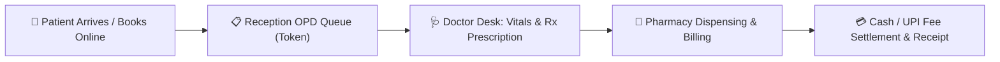
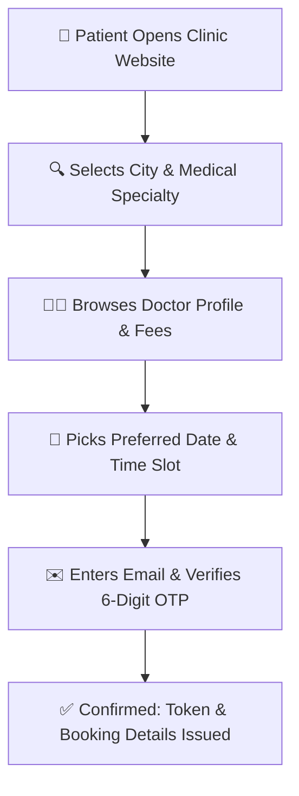

# User Guide: Clinic Management, OPD Queue & Digital Prescription Suite

This guide is written for **Clinic Administrators, Doctors, Receptionists, and Pharmacists** using the **Famalth Lynx Clinic & OPD Suite**. No programming knowledge is required. It provides comprehensive, step-by-step instructions on managing doctor schedules, booking patient appointments, handling reception token queues, recording vitals, generating digital prescriptions, collecting consultation fees, and enabling patient self-service booking.

---

## 📑 Table of Contents
1. [Overview & Clinic System Capabilities](#1-overview--clinic-system-capabilities)
2. [Reception Desk: Patient Registration & OPD Token Queue](#2-reception-desk-patient-registration--opd-token-queue)
3. [Doctor Consultation Desk: Vitals, Diagnosis & Rx Prescriptions](#3-doctor-consultation-desk-vitals-diagnosis--rx-prescriptions)
4. [Pharmacy Fulfillment Desk: 1-Tap Prescription Billing](#4-pharmacy-fulfillment-desk-1-tap-prescription-billing)
5. [Consultation Fees, Billing & Payment Settlement](#5-consultation-fees-billing--payment-settlement)
6. [Doctor Management & Consulting Schedule](#6-doctor-management--consulting-schedule)
7. [Public Patient Self-Service Booking Portal](#7-public-patient-self-service-booking-portal)
8. [Therapy & Multi-Session Subscriptions](#8-therapy--multi-session-subscriptions)
9. [Clinic Operating Status & Emergency Holiday Controls](#9-clinic-operating-status--emergency-holiday-controls)
10. [Frequently Asked Questions (FAQ)](#10-frequently-asked-questions-faq)

---

## 1. Overview & Clinic System Capabilities

The **Famalth Lynx Clinic Suite** (`lib/screens/clinic/clinic_dashboard_screen.dart`) is an all-in-one clinical practice management system integrated seamlessly with your inventory and billing engines.



### Core Workspaces:
1. **OPD Appointments Desk**: Token queue tracking, walk-in patient registration, upcoming booking banner, and status tracking (*Waiting*, *In Consultation*, *Completed*, *Cancelled*).
2. **Doctor Desk**: Dedicated clinical console for physicians to review patient medical history, record vitals, write diagnosis notes, prescribe medicines directly from current pharmacy stock, and issue vector PDF prescriptions.
3. **Pharmacy Fulfillment Desk**: Real-time queue showing doctor-approved prescriptions ready for medicine dispensing and checkout.
4. **Analytics & Performance**: Daily OPD footfall, doctor-wise revenue collections, and appointment trends.
5. **Public Patient Portal**: Branded web portal allowing patients to discover doctors, book appointment slots with Email OTP verification, view past visits, and cancel bookings.

---

## 2. Reception Desk: Patient Registration & OPD Token Queue

Navigate to **Clinic** $\rightarrow$ **Clinic Dashboard** $\rightarrow$ **Appointments Tab**:

```
+---------------------------------------------------------------------------------+
| 🏥 CLINIC OPD DESK & TOKEN QUEUE                                                |
|---------------------------------------------------------------------------------|
| [ + New Walk-in Appointment ]   [ 👨‍⚕️ Manage Doctors ]   [ 🏢 Clinic Status: OPEN ]|
|---------------------------------------------------------------------------------|
| Filter by Date: [ 26-Oct-2026 ▼ ]   Doctor: [ All Doctors ▼ ]   Status: [ All ] |
| Total Tokens: 24 | Waiting: 6 | In Consultation: 1 | Completed: 16 | Cancelled: 1|
|---------------------------------------------------------------------------------|
| Token | Patient Name       | Age/Sex | Doctor          | Fee   | Status | Action|
|-------|--------------------|---------|-----------------|-------|--------|-------|
| #101  | Rajesh Sharma      | 42 / M  | Dr. Sarah Adams | ₹500  | WAITING| [Call]|
| #102  | Ananya Patel       | 28 / F  | Dr. Sarah Adams | ₹500  | IN_CONS| [View]|
| #103  | Vikram Malhotra    | 65 / M  | Dr. David Chen  | ₹700  | COMPLET| [Bill]|
+---------------------------------------------------------------------------------+
```

### Step-by-Step Walk-in Registration:
1. Tap **+ New Walk-in Appointment** (`_openNewAppointmentDialog`).
2. Enter the patient details:
   - **Full Name**, **Mobile Phone Number**, **Email Address** *(optional)*.
   - **Age** and **Gender** (*Male / Female / Other*).
   - **Select Doctor**: Choose from the active doctor roster. The doctor's standard consultation fee automatically populates.
   - **Reason for Visit**: e.g., *"Persistent cough and fever for 3 days"*.
3. Tap **Issue Token & Book**.
4. The patient is assigned the next sequential token number and appears in the **Waiting Queue**.

---

## 3. Doctor Consultation Desk: Vitals, Diagnosis & Rx Prescriptions

When logged in as a doctor or accessing the **Doctor Desk Tab**:

1. Tap **Call Patient** or tap on any waiting patient card.
2. The consultation modal opens:

```
+---------------------------------------------------------------------------------+
| 🩺 CONSULTATION DESK — Token #101: Rajesh Sharma (42 / Male)                    |
|---------------------------------------------------------------------------------|
| [ Vitals: BP: 120/80 mmHg | Pulse: 72 bpm | Temp: 98.6°F | Wt: 74 kg | BMI: 24.2 ] |
|---------------------------------------------------------------------------------|
| Chief Complaints: [ Dry cough, mild sore throat, headache                     ] |
| Clinical Diagnosis: [ Acute Viral Pharyngitis                                 ] |
|---------------------------------------------------------------------------------|
| 💊 Prescribe Medicines (Linked to Pharmacy Inventory):                          |
| • Paracetamol 650mg  | 1-0-1 (After Food) | 3 Days | Qty: 6  | In Stock: 420  |
| • Azithromycin 500mg | 1-0-0 (After Food) | 3 Days | Qty: 3  | In Stock: 85   |
| • Cetirizine 10mg    | 0-0-1 (Bedtime)    | 5 Days | Qty: 5  | In Stock: 210  |
|                                                                                 |
| 🔬 Diagnostic Tests: [ Complete Blood Count (CBC) ] [ Chest X-Ray ]             |
| 💡 Advice & Diet:   [ Drink warm water, avoid cold beverages, rest 2 days    ] |
| 📅 Follow-up Date:   [ 30-Oct-2026 ]                                            |
|                                                                                 |
| [ 🖨️ Print Prescription PDF ]     [ 📤 Send to Pharmacy / Billing ] [ Save ]    |
+---------------------------------------------------------------------------------+
```

### Prescribing Medicines Directly from Inventory:
- As you type the medicine name, the system queries live pharmacy stock (`/api/clinic/medicines`).
- Displays available batch numbers, expiry dates, and current stock count so you never prescribe out-of-stock items.
- Presets for frequency: `1-0-1` (Morning & Night), `1-1-1` (Thrice daily), `0-0-1` (Bedtime), `SOS` (As needed).
- Tap **Print Prescription** (`clinic_prescription_pdf.dart`) to generate a clean, print-ready vector PDF with your clinic logo and signature.

---

## 4. Pharmacy Fulfillment Desk: 1-Tap Prescription Billing

The **Pharmacy Desk Tab** bridges doctor consultations with your medicine counter:

1. As soon as the doctor clicks **Send to Pharmacy / Billing**, the prescription appears under the **Pharmacy Queue**.
2. The pharmacy dispenser sees:
   - Patient Name, Token Number, Prescribing Doctor.
   - List of prescribed medicines, required quantities, and stock availability.
3. Tap **Send to Billing Draft**:
   - Automatically converts the prescription into an active sales bill in the main POS billing terminal (`salescreen.dart`).
   - The cashier simply collects payment and hands the medicines to the patient.
   - Inventory is deducted atomically from `stock_ledger` upon checkout.

---

## 5. Consultation Fees, Billing & Payment Settlement

To collect consultation fees directly at the clinic reception desk:

1. Tap **Accept & Pay** on the patient appointment card.
2. The **Clinic Payment Dialog** (`lib/screens/clinic/clinic_accept_pay_dialog.dart`) opens:

```
+-----------------------------------------------------------------+
| 💳 SETTLE CONSULTATION FEE — Token #101                        |
|-----------------------------------------------------------------|
| Patient: Rajesh Sharma                   Doctor: Dr. Sarah Adams|
| Consultation Fee:                        ₹500.00                |
| Applicable Tax (5% GST):                 ₹ 25.00                |
| Net Payable:                             ₹525.00                |
|-----------------------------------------------------------------|
| Payment Mode:  [ (•) Cash   ( ) UPI QR   ( ) Credit/Debit Card ]|
| Amount Paid:   [ ₹525.00                                      ] |
| Reference No:  [ UPI-REF-88392                                ] |
|                                                                 |
| [ ✓ ] Generate & Print Thermal Receipt                          |
|                                                                 |
|                 [ 🚀 COMPLETE PAYMENT & ISSUE BILL ]            |
+-----------------------------------------------------------------+
```

3. Select payment method (**Cash**, **UPI QR**, or **Card**).
4. Tap **Complete Payment & Issue Bill**.
5. The appointment status updates to **Paid / Completed**, and a standard invoice is posted into your financial cash ledger.

---

## 6. Doctor Management & Consulting Schedule

Clinic administrators can configure doctor rosters via the **Doctor Management Dialog** (`lib/screens/clinic/clinic_doctor_management_dialog.dart`):

### Configuring Doctor Details:
- **Full Name**: e.g., *Dr. Sarah Adams, MD*.
- **Specialty**: Choose from *General Physician, Cardiology, Dermatology, Pediatrics, Orthopedics, Dental, ENT, Gynecology*.
- **Qualifications**: e.g., *MBBS, MD (Internal Medicine)*.
- **Consultation Fee**: Standard OPD fee (e.g., ₹500.00).
- **Cabin / Room Number**: Room 102.
- **Available Days & Time Slots**: Monday through Saturday, 09:00 AM – 01:00 PM and 05:00 PM – 08:00 PM.
- **Public Directory Toggle**: When switched **ON**, this doctor appears on your clinic's public appointment booking website.

---

## 7. Public Patient Self-Service Booking Portal

Your clinic has a customer-facing web booking app (`lib/screens/clinic/public_appointment_booking_screen.dart`):



### Key Patient Features:
1. **Doctor Discovery**: Filter physicians by city, specialty, and consultation fee.
2. **Profile Inspection**: View doctor credentials, room number, hospital address, and next available slot.
3. **Email OTP Authentication**: Patients verify their email address with a 6-digit cryptographic OTP to prevent spam bookings.
4. **Patient Portal (My Appointments Tab)**:
   - Patients can view upcoming appointments and live token status.
   - Cancel appointments online if their schedule changes.
   - Download past prescription PDFs and medical invoices securely.
5. **Direct Connect**: 1-tap buttons to open a WhatsApp inquiry or call the clinic landline.

---

## 8. Therapy & Multi-Session Subscriptions

For clinics offering ongoing treatment packages (Physiotherapy, Dental Orthodontics, Dialysis, Panchakarma, Speech Therapy):

1. **Package Enrollment**: Enroll a patient in a multi-session package (e.g., *10 Physiotherapy Sessions for ₹4,000*).
2. **Session Punching**: Each time the patient visits, the receptionist taps **Consume Session**.
3. **Session Ledger**: Displays total sessions enrolled, sessions attended, balance remaining, and expiration date.

---

## 9. Clinic Operating Status & Emergency Holiday Controls

To temporarily pause walk-ins or update public portal messaging:

1. On the top-right of the Clinic Dashboard, tap **Clinic Status**.
2. **Emergency Closure**: Toggle **Closed Today** to immediately notify online patients:
   > *"Notice: The clinic is closed today for sanitation / holiday. Online appointments will resume tomorrow."*
3. All public booking slots for the day are locked automatically.

---

## 10. Frequently Asked Questions (FAQ)

#### Q1: Can a doctor prescribe medicines that are not currently in the pharmacy inventory?
> **A:** Yes. Doctors can type any brand name or custom composition. If an item is not linked to pharmacy stock, it will still print on the digital prescription PDF, but it will not create an automated inventory deduction.

#### Q2: What happens if a patient misses their token call?
> **A:** The receptionist can mark the appointment as **NO_SHOW** or move the token back into the **WAITING** queue with 1 tap.

#### Q3: Can a patient book an appointment online without paying upfront?
> **A:** Yes. By default, public bookings reserve the slot with status `SCHEDULED (PAY AT CLINIC)`. Patients pay at the reception counter when they arrive.

#### Q4: Can I print prescriptions on pre-printed clinic letterheads?
> **A:** Yes! In **Settings > Clinic Print Preferences**, you can toggle **Hide Header** so the vector PDF leaves blank space for your pre-printed clinic letterhead while printing only the doctor's prescription text and signature.
