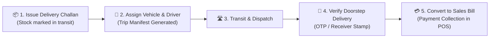

# User Guide: Delivery Challan, Fleet Vehicles & Transport Logistics

This guide is written for **Store Operators, Warehouse Logistics Coordinators, Fleet Managers, and Cashiers** using the **Famalth Lynx Transport & Dispatch Logistics Suite**. No programming knowledge is required. It provides step-by-step instructions on issuing delivery challans, registering fleet vehicles, assigning drivers, dispatching transport manifests, verifying doorstep customer deliveries, and converting delivery challans into settled sales bills.

---

## 📑 Table of Contents
1. [Overview & Logistics Capabilities](#1-overview--logistics-capabilities)
2. [Managing Fleet Vehicles & Drivers](#2-managing-fleet-vehicles--drivers)
3. [Issuing a Delivery Challan (Goods in Transit)](#3-issuing-a-delivery-challan-goods-in-transit)
4. [Assigning Trips & Dispatch Manifest (Loading Sheet)](#4-assigning-trips--dispatch-manifest-loading-sheet)
5. [Doorstep Delivery Verification (OTP & Signature)](#5-doorstep-delivery-verification-otp--signature)
6. [Converting Challans to Billed Invoices in POS](#6-converting-challans-to-billed-invoices-in-pos)
7. [Printing Delivery Challans & Thermal Slips](#7-printing-delivery-challans--thermal-slips)
8. [Frequently Asked Questions (FAQ)](#8-frequently-asked-questions-faq)

---

## 1. Overview & Logistics Capabilities

In wholesale, multi-branch distribution, and large-order retail/catering, goods often leave the warehouse **before** payment settlement. Transport laws (such as GST Rule 55 Delivery Challan) require a legal dispatch document to accompany the goods in transit.

The **Famalth Lynx Transport & Challan Suite** (`lib/screens/restaurant/delivery_challan_screen.dart`) provides complete end-to-end custody tracking:

### Key Workspaces in the Delivery Challan Module:
1. **Challans Tab**: Real-time status list of all challans (*Draft*, *Issued*, *Dispatched*, *Delivered*, *Billed*, *Cancelled*).
2. **Vehicles Tab**: Master fleet directory tracking vehicle numbers, vehicle models, ownership type (Self-Owned vs Third-Party Contractor), and operational status.
3. **Drivers Tab**: Driver database tracking driver names, phone numbers, commercial license numbers, and active trip assignments.
4. **Dispatch Manifest Tab**: Consolidated loading sheet grouping multiple customer deliveries onto a single truck route.

---

## 2. Managing Fleet Vehicles & Drivers

Navigate to **Operations** $\rightarrow$ **Delivery Challans & Transport**:

### Registering a Delivery Vehicle:
1. Tap the **Vehicles** tab.
2. Click **+ Add Vehicle** (`_openVehicleDialog`).
3. Fill in the vehicle details:
   - **Vehicle Number**: e.g., `MH-12-AB-1234` or `DL-1C-9876`.
   - **Vehicle Type**: Choose from *Mini Truck (Tata Ace / Bolero)*, *Delivery Van*, *Two-Wheeler (Bike / Scooter)*, *Heavy Truck*.
   - **Model / Make**: e.g., *Tata Ace Gold EV*.
   - **Ownership**: Select *Self-Owned* or *Third-Party Transporter*.
4. Click **Save Vehicle**.

### Registering a Driver:
1. Tap the **Drivers** tab.
2. Click **+ Add Driver** (`_openDriverDialog`).
3. Enter:
   - **Driver Name**: e.g., *Suresh Kumar*.
   - **Mobile Phone**: For instant trip SMS/WhatsApp alerts.
   - **Driving License Number**: For commercial transport compliance.
4. Click **Save Driver**.

---

## 3. Issuing a Delivery Challan (Goods in Transit)

When dispatching goods for approval, job work, exhibition, or credit supply:

1. Tap **+ Issue Challan** from the Challans tab.
2. **Customer & Destination**:
   - Select or search the customer / recipient branch.
   - The shipping address and GSTIN/Tax ID populate automatically.
3. **Add Items**:
   - Scan barcodes or search items from your warehouse catalog.
   - Specify dispatched quantity, unit rate, and HSN code.
4. **Reason for Transportation**:
   - Select: *Supply on Approval*, *Job Work Dispatch*, *Branch Transfer*, *Exhibition Demonstration*, or *Regular Sale Dispatch*.
5. Click **Create & Issue Challan**.
   - The document generates an official sequential numbering (e.g., `DC-2026-0089`).
   - Dispatched quantities are logged in custody tracking.

---

## 4. Assigning Trips & Dispatch Manifest (Loading Sheet)

To group orders into a route run:

1. Select one or more issued delivery challans.
2. Tap **Assign Transport / Dispatch Trip** (`_openAssignTransportDialog`).
3. Select the **Assigned Vehicle** and **Assigned Driver**.
4. Enter starting odometer reading and dispatch notes (e.g., *"Route: North City Outlets"*).
5. Click **Confirm Dispatch**:
   - Challan status changes to **Dispatched / In Transit**.
   - Print the **Consolidated Loading Manifest** for the driver showing stop-by-stop delivery stops, contact persons, and item counts.

---

## 5. Doorstep Delivery Verification (OTP & Signature)

When the driver reaches the customer premises:

1. Open the Challan on the delivery tablet / console.
2. Tap **Verify Delivery** (`_openVerifyDeliveryDialog`).
3. Enter:
   - **Received By Person Name**: Name of receiving storekeeper.
   - **Receiver Mobile / Verification Code**.
   - **Delivery Notes**: e.g., *"Received in good condition, 10 cartons undamaged"*.
4. Tap **Confirm Delivery**:
   - Challan updates to **DELIVERED**.
   - A digital timestamped delivery receipt is created.

---

## 6. Converting Challans to Billed Invoices in POS

Once delivered or when the customer confirms acceptance:

1. On the Delivery Challan list, click **Open in Billing / Convert to Sale** (`_openInBillingScreen`).
2. The entire challan payload (customer details, item codes, quantities, agreed rates, and tax modes) loads directly into the main POS checkout screen (`salescreen.dart`).
3. Apply any payment discounts or customer credits.
4. Settle payment via Cash, Card, UPI, or Credit Ledger.
5. The original Delivery Challan status automatically marks as **BILLED** with the linked Invoice Number (`INV-XXXX`).

---

## 7. Printing Delivery Challans & Thermal Slips

- **Standard A4 / Letter PDF**: Complete legal transport challan with sender & receiver details, HSN breakdown, transport details, and dual signature blocks (*Dispatched By* / *Received By*).
- **Thermal Receipt Slip (80mm)**: Compact slip for bike riders and quick local delivery verification.

---

## 8. Frequently Asked Questions (FAQ)

#### Q1: Does issuing a delivery challan immediately affect accounts receivable?
> **A:** No. A delivery challan represents movement of goods in custody without recognizing financial debt until converted into an official tax invoice in POS.

#### Q2: Can a single delivery vehicle carry multiple challans for different customers?
> **A:** Yes! The Dispatch Manifest feature allows assigning 1 vehicle and 1 driver to multiple customer challans on a unified route loading sheet.

#### Q3: What happens if a customer partially rejects items on delivery?
> **A:** During the **Convert to Sale** step in POS, the cashier can edit the quantities to match the actual accepted goods. The difference returns automatically to warehouse stock.
