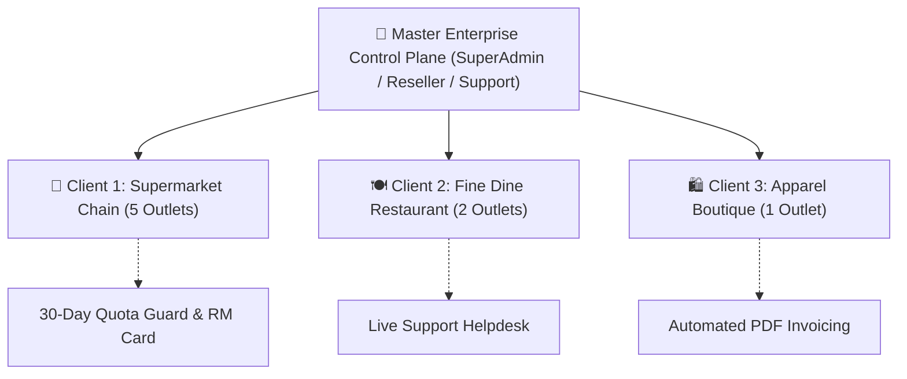
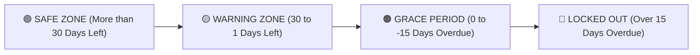
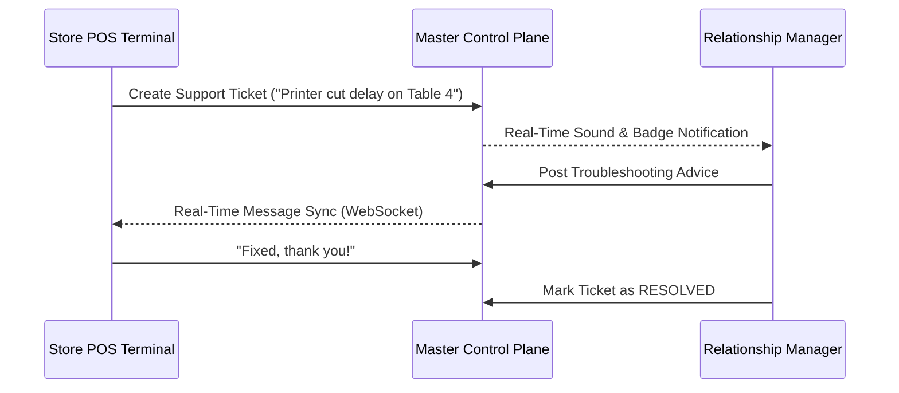

# User Guide: Famalth Lynx Enterprise SaaS Control Plane & Multi-Tenant Fleet Management

This guide is written for **SaaS SuperAdmins, Resellers, Operations Managers, Relationship Managers, and Support Executives**. No programming knowledge is required. It provides step-by-step instructions on managing software licenses, tenant organizations, store outlets, relationship manager assignments, support helpdesk tickets, automated subscription invoices, and database health diagnostics across the **Famalth Lynx** ecosystem.

---

## 📑 Table of Contents
1. [Overview & What is the Master Control Plane?](#1-overview--what-is-the-master-control-plane)
2. [Accessing the Control Plane (Web & Windows Standalone Console)](#2-accessing-the-control-plane-web--windows-standalone-console)
3. [Master IAM & Staff Roles](#3-master-iam--staff-roles)
4. [Executive Fleet Dashboard (Metrics & KPI Overview)](#4-executive-fleet-dashboard-metrics--kpi-overview)
5. [Tenant Lifecycle & Outlet Management (Kill-Switch & Activation)](#5-tenant-lifecycle--outlet-management-kill-switch--activation)
6. [30-Day Quota Guard, Grace Periods & License Renewal](#6-30-day-quota-guard-grace-periods--license-renewal)
7. [Relationship Manager (RM) Assignment & Client Help Cards](#7-relationship-manager-rm-assignment--client-help-cards)
8. [Outlet-Wise Support Helpdesk & Live Messaging](#8-outlet-wise-support-helpdesk--live-messaging)
9. [Automated Subscription Vector Invoices & CSV Export](#9-automated-subscription-vector-invoices--csv-export)
10. [Sandboxed Data Doctor & Diagnostic Query Studio](#10-sandboxed-data-doctor--diagnostic-query-studio)
11. [Frequently Asked Questions (FAQ)](#11-frequently-asked-questions-faq)

---

## 1. Overview & What is the Master Control Plane?

The **Enterprise Control Plane** (`lib/screens/settings/master_control_plane_screen.dart`) is the central mission-control station for the entire software ecosystem. While individual retail stores and restaurants operate on their dedicated local databases, the Control Plane gives you a unified command center across all deployed clients.



### Key Capabilities:
- **Zero-Downtime Tenant Governance**: Activate, suspend, or upgrade client accounts instantly.
- **30-Day Quota Guard**: Prevents unexpected software disruption while providing an automated countdown grace period.
- **Dedicated RM Assignment**: Directly associates a named Relationship Manager with their direct WhatsApp number and email to each tenant.
- **Integrated Outlet Helpdesk**: Store cashiers can file support tickets right from their POS screen, allowing your central team to troubleshoot and reply in real time.
- **Data Doctor Health Studio**: Run targeted diagnostic queries across store databases to repair broken sequences or inspect anomalies without raw database credentials.

---

## 2. Accessing the Control Plane (Web & Windows Standalone Console)

You can launch the Master Control Plane in two ways:

### Option A: Windows Standalone Console (`FamalthLynx-ControlPlane.exe`)
For administrative staff, resellers, and DevOps, a standalone executable installer is provided:
1. Run `FamalthLynx-ControlPlane-Setup.exe` (built via `installer/enterprise_control_plane.iss`).
2. Launch the desktop shortcut: **Famalth Lynx Enterprise Control Plane**.
3. The dedicated login screen appears (`lib/screens/control_plane/control_plane_login_screen.dart`).

```
+--------------------------------------------------------------------------+
|  🏢 FAMALTH LYNX ENTERPRISE CONTROL PLANE                                 |
|  Master Fleet Operations & Tenant Management                             |
|--------------------------------------------------------------------------|
|  Server Connection: [ https://api.yourdomain.com:5000 ] [⚡ Test Ping]   |
|                                                                          |
|  Username / Email:  [ superadmin@famalth.com                          ] |
|  Master Password:   [ ******************                               ] |
|                                                                          |
|  [ ✓ ] Remember this terminal credentials                                |
|                                                                          |
|                         [ 🚀 SECURE ENTERPRISE LOGIN ]                   |
|                                                                          |
|  [ Forgot Password? ]                          [ Need Setup Bootstrap? ] |
+--------------------------------------------------------------------------+
```

### Option B: From Within the Main POS Application
If logged in as a Master Administrator or Developer:
1. Go to **Settings** $\rightarrow$ **System Settings**.
2. Scroll to the **Enterprise SaaS & Fleet** section.
3. Click **Launch Master Control Plane**.

---

## 3. Master IAM & Staff Roles

The Control Plane provides strictly segregated roles so operators only see what they are authorized to handle:

| Role Name | Scope & Authority | Allowed Actions |
| :--- | :--- | :--- |
| **SUPER_ADMIN** | Complete System Authority | Full tenant lifecycle, license modification, staff creation, billing approvals, Data Doctor execution. |
| **RESELLER_ADMIN** | Assigned Franchise / Region | Manage tenants under their reseller code, extend trial licenses, approve incoming customer payments. |
| **DEVELOPER** | Engineering & Maintenance | Live DB Doctor execution, diagnostic error analyzer, schema extractor, bug triage. |
| **SUPPORT_AGENT** | Customer Care & Support | Manage support tickets, reply to outlet cashiers, view store status, assign tickets to RMs. |
| **RELATIONSHIP_MANAGER** | Client Success | Review assigned client health, monitor renewal dates, send announcements and promotional offers. |

---

## 4. Executive Fleet Dashboard (Metrics & KPI Overview)

Upon logging in, the **Overview Tab** gives you high-level business intelligence across your client network:

```
+--------------------------------------------------------------------------+
| 📊 EXECUTIVE FLEET OVERVIEW                                              |
|--------------------------------------------------------------------------|
|  [ 🏢 142 Active Tenants ]   [ 🏪 380 Outlets Live ]   [ 🛡️ 98.4% Health ]|
|  [ ⚠️ 8 In Grace Period  ]   [ 💳 ₹1,24,500 MRR    ]   [ 🎫 4 Open Tickets] |
+--------------------------------------------------------------------------+
```

### Dashboard Cards Explained:
- **Active Tenants**: Total business entities with live operating databases.
- **Outlets Live**: Individual store locations currently connected to the sync engine.
- **In Grace Period**: Stores whose standard license expired within the last 15 days, currently operating on emergency grace mode.
- **Monthly Recurring Revenue (MRR)**: Real-time subscription revenue run rate.
- **Open Support Tickets**: Customer requests waiting for agent response.

---

## 5. Tenant Lifecycle & Outlet Management (Kill-Switch & Activation)

Navigate to the **Tenants Tab** to search, filter, and inspect any client organization.

```
+--------------------------------------------------------------------------+
| 🔍 Search by Legal Name, Trade Name, Client Code, or Phone...            |
| Filter: [ All Statuses ▼ ]  [ All Tiers ▼ ]  [ All Resellers ▼ ]          |
|--------------------------------------------------------------------------|
| Code     | Client Name       | Outlets | Tier       | Expiry     | Status|
|----------|-------------------|---------|------------|------------|-------|
| TNT-1001 | Apex Hypermarket  | 4 / 5   | Enterprise | 31-Dec-2027| Active|
| TNT-1002 | Cafe Delight      | 1 / 1   | Standard   | 15-Nov-2026| Active|
| TNT-1003 | Spice Garden Rest | 2 / 2   | Pro        | 22-Oct-2026| Grace |
+--------------------------------------------------------------------------+
```

### Performing Actions on a Tenant:
1. **Click on any Tenant Row** to open the **Tenant Action Panel**:
   - **Extend License**: Fast 30-day, 90-day, or 1-year renewal with automated invoice generation.
   - **Toggle Status (Kill Switch)**: Instantly suspend a delinquent account. All connected POS terminals will transition into read-only mode or display a license suspension notice.
   - **Assign Relationship Manager**: Select a designated manager who appears on the client's POS header.
   - **Export Renewals CSV**: Download a spreadsheet of upcoming renewals for your sales team.

---

## 6. 30-Day Quota Guard, Grace Periods & License Renewal

The system protects both your software revenue and store operations using an automated **3-Tier Warning System**:



### Warning Levels on the Client's POS Terminal:
1. **Safe Zone ($> 30\text{ days}$)**: No visible banners. POS runs seamlessly.
2. **Warning Zone ($30\text{ to }1\text{ day}$)**: An amber banner appears at the top of the POS screen:
   > *"Notice: Your subscription renewal is due in 18 days. Click to renew or contact your Relationship Manager."*
3. **Grace Period (Expired, but $< 15\text{ days}$)**: A prominent orange notification banner allows the store to continue billing uninterrupted while urging payment:
   > *"Alert: Subscription expired on 10-Oct-2026. Emergency grace period active (12 days remaining). Avoid service interruption by settling invoice #INV-8821."*
4. **Locked Out ($> 15\text{ days}$ overdue)**: Transactions are locked until an authorized renewal or payment approval is issued via the Control Plane.

### Approving a Payment:
1. When a client transfers funds via UPI, Bank Wire, or Cash:
2. Open **Tenants Tab** $\rightarrow$ Locate Client $\rightarrow$ Tap **Approve Payment & Extend**.
3. Choose the renewal duration (e.g., 1 Year) and enter the payment reference code.
4. The system immediately updates the cloud license record and emails the vector PDF invoice to the client's registered billing email.

---

## 7. Relationship Manager (RM) Assignment & Client Help Cards

Every tenant can be assigned a dedicated personal **Relationship Manager**.

### How it Looks on the Client's POS (`lib/widgets/relationship_manager_card.dart`):
When a cashier or store owner clicks the support icon in their POS header:
- They see their RM's **Photo, Full Name, Direct Phone Number, and Official Email**.
- A **"Chat on WhatsApp"** button opens a pre-filled WhatsApp conversation directly to the RM's mobile number:
  > *"Hello Alex, this is Cafe Delight (Client Code: TNT-1002). We need assistance with our invoice renewal."*

```
+-------------------------------------------------------+
|  👤 Your Dedicated Relationship Manager               |
|-------------------------------------------------------|
|  [ Photo ]  Alex Morgan                               |
|             Senior Accounts Lead                      |
|             📱 +91 98765 43210                        |
|             ✉️ alex.m@famalth.com                      |
|                                                       |
|  [ 💬 Open WhatsApp Chat ]    [ 📞 Call Direct Line ] |
+-------------------------------------------------------+
```

---

## 8. Outlet-Wise Support Helpdesk & Live Messaging

Store cashiers can file questions or report issues without leaving their checkout screen via the **Support Helpdesk Dialog** (`lib/widgets/support_helpdesk_dialog.dart`).



### Steps for Support Agents in Control Plane:
1. Navigate to the **Tickets Tab**.
2. Filter by status: **Open**, **In-Progress**, or **Resolved**.
3. Tap on a ticket to view the conversation history and outlet hardware details.
4. Type your reply in the input box and tap **Send Message**.
5. Once resolved, tap **Mark as Resolved**.

---

## 9. Automated Subscription Vector Invoices & CSV Export

The Control Plane includes an automated vector PDF invoice generation service (`backend/services/subscriptionInvoicePdf.service.ts`).

### Key Features of Generated Invoices:
- Crisp vector PDF rendering that never gets blurry when zoomed or printed.
- Legal tax invoice compliance (GSTIN / VAT IDs, SAC code 997331 for software licensing).
- Clear breakdown of base tier price, add-on terminal quotas, tax amounts, and currency formatting.
- Downloadable directly from the Control Plane or via public tokenized link.

### Exporting Renewals for Financial Forecasting:
1. Go to the **Fleet Overview** or **Tenants Tab**.
2. Click **Export Renewals CSV**.
3. A spreadsheet `tenant_renewals_YYYY-MM-DD.csv` is downloaded, containing:
   - Client Code, Trade Name, Registered Contact, Expiry Date, Assigned RM, Renewal Amount, and Current Payment Status.

---

## 10. Sandboxed Data Doctor & Diagnostic Query Studio

For technical support executives and developers, the **Data Doctor Studio** allows targeted SQL diagnostics without exposing database master credentials:

```
+--------------------------------------------------------------------------+
| 🩺 DATA DOCTOR DIAGNOSTIC STUDIO                                         |
|--------------------------------------------------------------------------|
|  Target Client: [ TNT-1002: Cafe Delight ▼ ]   Outlet: [ Outlet #1 ▼ ]   |
|                                                                          |
|  Diagnostic Query:                                                       |
|  SELECT item_code, item_name, current_stock FROM item_master             |
|  WHERE current_stock < 0;                                                |
|                                                                          |
|  [ ⚡ EXECUTE SANDBOXED QUERY ]           [ 📖 Schema Dictionary ]       |
+--------------------------------------------------------------------------+
```

### Safety Guardrails:
- **Mandatory Tenant Scoping**: Every executed query automatically runs against the selected tenant's isolated database schema.
- **Audit Logging**: Every single query executed, its execution time, row count returned, and the staff member's user ID are logged in `diagnostic_query_audit_logs`.
- **Pre-Built Safe Recipes**: One-click diagnostic templates for common checks:
  - Check Broken Stock Ledger Balances.
  - Find Unsettled Tables Older Than 24 Hours.
  - Reset Sequence Generator Gaps.

---

## 11. Frequently Asked Questions (FAQ)

#### Q1: What happens if a store's internet disconnects during the 30-day quota countdown?
> **A:** The POS terminal caches its license state locally. If offline, it continues normal operations and decrements the countdown locally. Once reconnected to the internet, it syncs with the Control Plane and reflects the latest license extension instantly.

#### Q2: Can a store cashier change their assigned Relationship Manager?
> **A:** No. Only SuperAdmins and Reseller Admins can assign or change Relationship Managers from the Control Plane.

#### Q3: Does the Data Doctor allow modifying client inventory or invoices?
> **A:** By default, Data Doctor runs in read-only diagnostic mode for support agents. Write or update operations require explicit SuperAdmin or Developer role clearance and create an indelible audit trail.

#### Q4: How do I export subscription invoices for accounting audits?
> **A:** In the Control Plane, go to **Tenants** $\rightarrow$ Click the **Download Invoice** button next to any tenant row to retrieve their official PDF invoice. You can also use **Export Renewals CSV** to get the aggregated financial ledger for all tenants.
