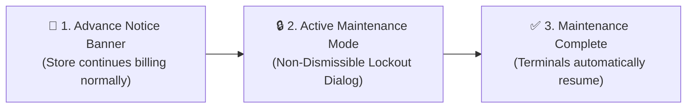

# User Guide: System Maintenance Mode & Non-Dismissible Lockout Dialog

This guide is written for **Store Owners, Cashiers, Branch Managers, and DevOps Administrators**. It explains how **System Maintenance Mode**, the **Advance Notice Banner**, and the **Non-Dismissible Lockout Dialog** work to safeguard your business data during scheduled upgrades, database migrations, and cloud synchronization.

---

## 📑 Table of Contents
1. [What is System Maintenance Mode & Why is it Used?](#1-what-is-system-maintenance-mode--why-is-it-used)
2. [Phase 1: Advance Maintenance Notice Banner](#2-phase-1-advance-maintenance-notice-banner)
3. [Phase 2: Active Maintenance & Non-Dismissible Lockout Dialog](#3-phase-2-active-maintenance--non-dismissible-lockout-dialog)
4. [Phase 3: Automatic Resumption & Terminal Unlocking](#4-phase-3-automatic-resumption--terminal-unlocking)
5. [How Administrators Activate Maintenance Mode](#5-how-administrators-activate-maintenance-mode)
6. [Emergency Offline Override Procedures](#6-emergency-offline-override-procedures)
7. [Frequently Asked Questions (FAQ)](#7-frequently-asked-questions-faq)

---

## 1. What is System Maintenance Mode & Why is it Used?

During critical server operations—such as database schema upgrades, major version updates, cloud data synchronization, or server hardware maintenance—writing new invoices or stock movements can lead to corrupted ledgers or mismatched inventory numbers.

To guarantee **100% data integrity**, Famalth Lynx provides an automated **Two-Stage Maintenance Safeguard**:



---

## 2. Phase 1: Advance Maintenance Notice Banner

Before taking the system into active maintenance, administrators can schedule an advance notice banner (similar to banking or cloud hosting platforms).

### What Appears on POS Terminals:
An amber notification banner appears across the top of all cashier terminals and dashboards:

```
+---------------------------------------------------------------------------------+
| ⚠️ SCHEDULED MAINTENANCE NOTICE                                                |
| System maintenance is scheduled for tonight at 11:30 PM (Est. Duration: 30m).   |
| Please complete all pending sales and shift handovers before this time.        |
+---------------------------------------------------------------------------------+
```

- **Can cashiers still bill?** **Yes.** During the advance notice period, store operations continue 100% normally. The banner simply alerts cashiers to complete pending customer checkouts.

---

## 3. Phase 2: Active Maintenance & Non-Dismissible Lockout Dialog

When the administrator triggers active maintenance:

1. Any in-flight API request receives a structured `HTTP 503 Service Unavailable` response.
2. The POS application instantly renders the **Non-Dismissible Maintenance Lockout Dialog** (`lib/core/api/api_client.dart`):

```
+---------------------------------------------------------------------------------+
|                                                                                 |
|                        🛠️ SYSTEM UNDER SCHEDULED MAINTENANCE                     |
|                                                                                 |
|         System maintenance is active. Store operations are temporarily paused   |
|         while we upgrade the cloud database schema and perform data security    |
|         checks. No data will be lost.                                           |
|                                                                                 |
|                     Estimated Time Remaining: 14 Minutes                        |
|                                                                                 |
|                                [ ⏳ Progress Bar ]                              |
|                                                                                 |
|                     [ 🔄 Check Server Status & Reconnect ]                       |
|                                                                                 |
+---------------------------------------------------------------------------------+
```

### Safety Features of the Lockout Dialog:
- **Non-Dismissible**: Cashiers cannot close, dismiss, or bypass the modal. This ensures no half-written transactions can corrupt the database while tables are altering.
- **Real-Time Countdown**: Displays estimated remaining minutes and maintenance reason.
- **Automatic Health Heartbeat**: The dialog polls the server health endpoint in the background every 10 seconds.

---

## 4. Phase 3: Automatic Resumption & Terminal Unlocking

As soon as the engineering team completes the upgrade and disables maintenance mode:
1. The server resumes serving standard HTTP 200 responses.
2. The background heartbeat detects that maintenance has ended.
3. The lockout dialog **automatically closes on its own** without requiring the cashier to restart the computer or log in again.
4. Normal checkout and table billing resume immediately.

---

## 5. How Administrators Activate Maintenance Mode

SuperAdmins, DevOps engineers, and Enterprise Resellers can activate maintenance in two ways:

### Method A: From the Enterprise Control Plane
1. Open the **Master Control Plane Console** (`master_control_plane_screen.dart`).
2. Navigate to **System Governance** $\rightarrow$ **Maintenance Operations**.
3. Set the **Estimated Duration** (e.g. `20 Minutes`).
4. Enter the **Notice Message** explaining the update.
5. Click **Activate System Maintenance**.

### Method B: Via Admin REST API
Administrators can trigger maintenance via an automated deployment script:
```bash
curl -X POST http://localhost:5000/api/system/maintenance \
  -H "Authorization: Bearer <SUPER_ADMIN_JWT>" \
  -H "Content-Type: application/json" \
  -d '{
    "isActive": true,
    "title": "Scheduled Database Migration",
    "message": "Upgrading clinic and inventory database indexes.",
    "durationMinutes": 20
  }'
```

---

## 6. Emergency Offline Override Procedures

In the rare event that a store is completely isolated without internet access and needs to clear an emergency lockout:
1. Local offline standalone stores do not trigger maintenance unless explicitly activated on their local backend instance (`localhost:5000`).
2. Logging in with the Master Recovery PIN or Developer credentials automatically bypasses the maintenance gate.

---

## 7. Frequently Asked Questions (FAQ)

#### Q1: Will pending sales or cart items be deleted during maintenance?
> **A:** No. If a cashier had items scanned in their POS cart, the items remain held in local memory. Once maintenance completes, the cart reappears intact for checkout.

#### Q2: Can administrators still access the system during maintenance?
> **A:** Yes! The Enterprise Control Plane and administrative endpoints (`/control-plane/*`, `/api/system/*`) are exempt from the maintenance lockout so engineers can execute migrations safely.

#### Q3: Does the maintenance lockout affect the online customer dining portal?
> **A:** Yes. If active maintenance is triggered, customer self-ordering QR pages display a polite message: *"We are currently upgrading our systems. Please place your order directly with your floor server."*
