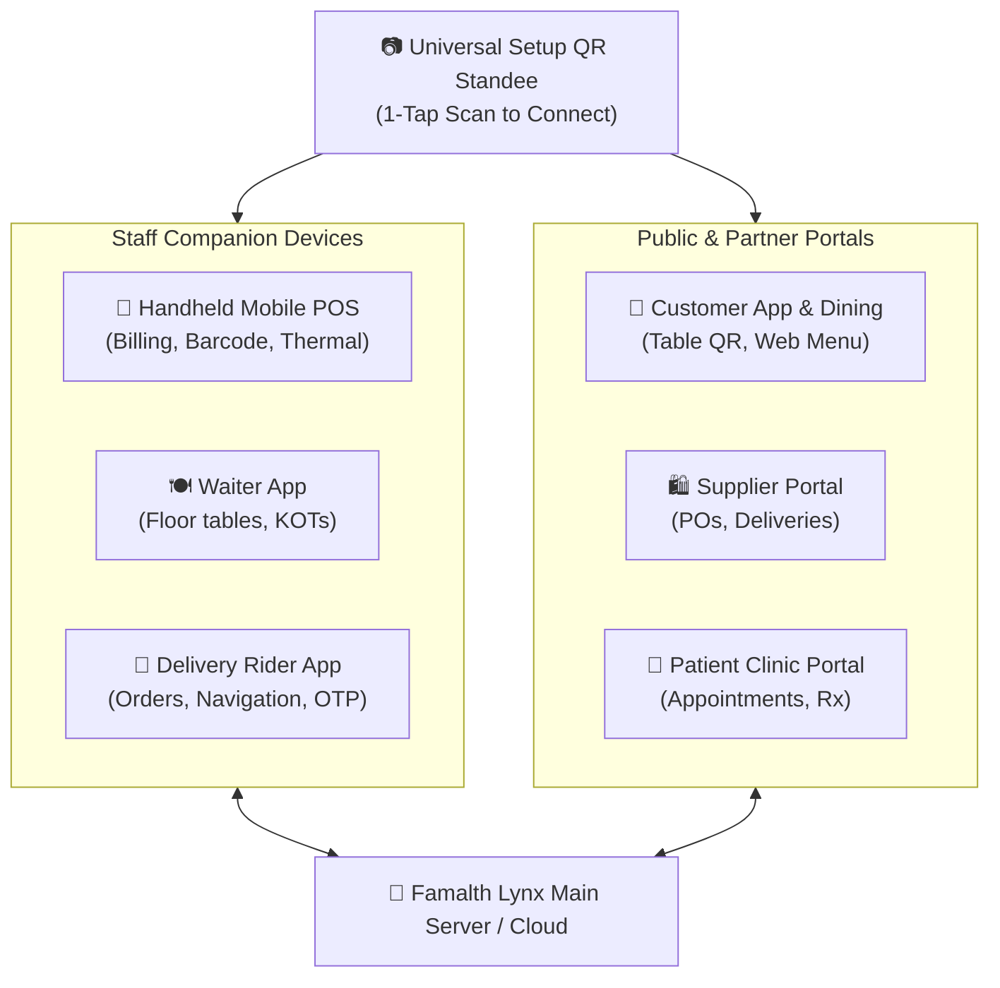

# 📱 User Guide: Mobile Billing Suite & Universal Companion Apps

This guide explains how store staff, waiters, cashiers, delivery riders, and customers use the **Famalth Lynx Mobile Suite**. It covers the handheld mobile POS billing screen, quick-access operational sheets, role-based companion applications, and 1-tap **Scan-to-Connect** setup via QR standees.

---

## 📑 Table of Contents
1. [Overview of the Mobile Ecosystem](#1-overview-of-the-mobile-ecosystem)
2. [Instant Setup: Scan-to-Connect QR Standees](#2-instant-setup-scan-to-connect-qr-standees)
   - [Staff Device Setup (`AppSetupQrMode.staff`)](#staff-device-setup-appsetupqrmodestaff)
   - [Customer Standees & Tent Cards (`AppSetupQrMode.customer`)](#customer-standees--tent-cards-appsetupqrmodecustomer)
3. [Handheld Mobile Billing Terminal (`MobileBillingAppScreen`)](#3-handheld-mobile-billing-terminal-mobilebillingappscreen)
   - [Tab 0: High-Speed Mobile Checkout](#tab-0-high-speed-mobile-checkout)
   - [Tab 1: Orders & Instant Thermal Reprints](#tab-1-orders--instant-thermal-reprints)
   - [Tab 2: Recurring Subscriptions](#tab-2-recurring-subscriptions)
   - [Tab 3: Real-Time Mobile Analytics](#tab-3-real-time-mobile-analytics)
   - [Tab 4: Workstation Profile & Hardware](#tab-4-workstation-profile--hardware)
4. [Quick-Access Mobile Bottom Sheets](#4-quick-access-mobile-bottom-sheets)
   - [Mobile Bill Modify Sheet](#mobile-bill-modify-sheet)
   - [Mobile Cash Ledger & Drawer In/Out](#mobile-cash-ledger--drawer-inout)
   - [Mobile Customer Ledger & Credit Recovery](#mobile-customer-ledger--credit-recovery)
   - [Mobile Item Master & Price Lookup](#mobile-item-master--price-lookup)
   - [Mobile Stock Balance Lookup](#mobile-stock-balance-lookup)
5. [Role-Specific Companion Applications](#5-role-specific-companion-applications)
   - [🍽️ Waiter Floor App (`main_waiter.dart`)](#️-waiter-floor-app-main_waiterdart)
   - [📱 Contactless Table Dining (`main_dining.dart`)](#-contactless-table-dining-main_diningdart)
   - [🛵 Delivery Rider App (`main_rider.dart`)](#-delivery-rider-app-main_riderdart)
   - [🛍️ Supplier Wholesale Portal (`main_supplier.dart`)](#️-supplier-wholesale-portal-main_supplierdart)
   - [🛒 Customer Online Shopping App (`main_customer.dart`)](#-customer-online-shopping-app-main_customerdart)
   - [🏥 Clinic OPD & Patient Portal (`public_appointment_booking_screen.dart`)](#-clinic-opd--patient-portal-public_appointment_booking_screendart)
6. [Offline Reliability & Network Transition](#6-offline-reliability--network-transition)

---

## 1. Overview of the Mobile Ecosystem

Famalth Lynx is designed to run seamlessly not only on full-sized Windows desktop POS terminals, but also on **smartphones, Android handheld POS devices (Sunmi, iMin, Pax), tablets, and iPads**.



---

## 2. Instant Setup: Scan-to-Connect QR Standees

Connecting a staff phone or tablet to the store network usually requires typing complex IP addresses (e.g. `http://192.168.1.15:3000`). With the **Scan-to-Connect** feature, setup takes less than **3 seconds**.

### Staff Device Setup (`AppSetupQrMode.staff`)

1. On the main POS terminal, open **Settings** $\rightarrow$ Click **"Staff Setup QR"** (or use the QR button on the dashboard).
2. The system opens the **Universal Setup Standee Dialog** showing:
   - Auto-detected LAN IP (e.g. `http://192.168.1.15:3000`) and Cloud Server URL.
   - Selected Store Branch & Outlet Code (`OUTLET001`).
3. On the staff member's mobile phone:
   - Open the **Famalth Lynx Mobile** or **Waiter** app.
   - Tap **"Scan QR to Connect"** on the startup splash screen.
   - Point the camera at the standee on the POS screen.
4. The mobile app immediately configures the backend connection URL, sets the store name, and opens the Fast PIN login screen. No manual typing required!

```
+-------------------------------------------------------+
|  📷 CONNECT STAFF COMPANION APP                       |
|-------------------------------------------------------|
|  Scan this QR code from any Waiter, Cashier, or       |
|  Rider mobile device on the store Wi-Fi network.      |
|                                                       |
|                  ┌─────────────────┐                  |
|                  │  █████████████  │                  |
|                  │  ██         ██  │                  |
|                  │  ██  QRCODE ██  │                  |
|                  │  ██         ██  │                  |
|                  │  █████████████  │                  |
|                  └─────────────────┘                  |
|                                                       |
|  Server: http://192.168.1.15:3000                     |
|  Store:  Downtown Flagship (OUTLET001)                |
|                                                       |
|  [ 🖨️ Print Acrylic Counter Standee ]   [ ✕ Close ]    |
+-------------------------------------------------------+
```

### Customer Standees & Tent Cards (`AppSetupQrMode.customer`)

From the same dialog, toggle to **Customer QR Mode**:
- Automatically embeds the digital dining and online ordering URL: `http://<server-ip>:3000/#/dining?outlet_id=1`.
- Click **"Print Counter Standee"** to generate a formatted PDF with your store logo, table number, and instructions for customers to scan and order from their phones.

---

## 3. Handheld Mobile Billing Terminal (`MobileBillingAppScreen`)

Designed for line-busting in retail shops, outdoor dining, food trucks, and pop-up events, the Mobile Billing screen brings full enterprise checkout to your phone.

### Tab 0: High-Speed Mobile Checkout
- **Instant Camera Barcode Scanning**: Tap the barcode icon to open the camera scanner (`mobile_scanner`). Instantly adds scanned items to the cart.
- **Category Filter Chips**: Horizontally scrollable chips (`All`, `Beverages`, `Grocery`, `Snacks`) for rapid touch navigation.
- **Cart Summary Drawer**: Displays line items, quantity increment/decrement, line-level discounts, and tax breakups.
- **Tender Settle**: One-tap payment buttons for `CASH`, `UPI QR`, `CARD`, and `CREDIT`.
- **Bluetooth / ESC-POS Printing**: Wirelessly sends formatted receipts to 58mm or 80mm mobile thermal belt printers.

### Tab 1: Orders & Instant Thermal Reprints
- Real-time search across historical invoices by bill number, customer name, or phone.
- Filter orders by **Today**, **This Week**, **This Month**, or **Custom Date Range**.
- One-tap actions:
  - **Reprint Receipt**: Prints thermal slip or shares digital PDF via WhatsApp.
  - **Modify Bill**: Loads the bill into the modification sheet for items revision.
  - **Void / Refund**: Cancels the invoice with manager authorization and restores inventory.

### Tab 2: Recurring Subscriptions
- Track daily recurring deliveries (e.g. Milk, Newspaper, Water Cans).
- View active subscriptions, pause/resume customer schedules, and verify delivery status.

### Tab 3: Real-Time Mobile Analytics
- **Live Net Revenue & Bills Count**: Instant glance at today's counter takings.
- **Payment Method Split**: Real-time breakdown of Cash vs. UPI vs. Card vs. Customer Credit.
- **Outstanding Balances**: Total pending customer credit receivables and supplier payables.
- **Top 5 Velocity Items**: Today's highest-selling products by quantity and revenue.

### Tab 4: Workstation Profile & Hardware
- Active cashier name, role, assigned register, and connected Bluetooth printer status.

---

## 4. Quick-Access Mobile Bottom Sheets

Store operators can swipe up from the bottom menu to access specialized utility sheets without leaving the billing workflow:

| Bottom Sheet | Function & Use Case |
| :--- | :--- |
| **Mobile Bill Modify Sheet** (`mobile_bill_modify_sheet.dart`) | Safely edit quantities, add missed items, or adjust discounts on an existing invoice with automatic stock reconciliation. |
| **Mobile Cash Ledger Sheet** (`mobile_cash_ledger_sheet.dart`) | View live cash drawer totals, perform mid-day cash drops (Payout), or add petty cash float (Pay-in) with audit notes. |
| **Mobile Customer Ledger Sheet** (`mobile_customer_ledger_sheet.dart`) | Lookup customer outstanding balances, view credit history, collect partial debt payments, and issue digital payment vouchers. |
| **Mobile Item Master Sheet** (`mobile_item_master_sheet.dart`) | Quick item search, check selling prices, verify tax slabs, and update item barcodes using the phone's camera. |
| **Mobile Stock Balance Sheet** (`mobile_stock_balance_sheet.dart`) | Real-time stock audit across warehouse aisles, checking current on-hand quantities, reorder levels, and expired batches. |

---

## 5. Role-Specific Companion Applications

Famalth Lynx includes standalone, lightweight applications compiled for specific roles:

### 🍽️ Waiter Floor App (`main_waiter.dart`)
- **Target**: Floor captains, restaurant servers, and banquet order-takers.
- **Key Features**: Visual dining floor plan, table status colors (Free, Occupied, Billed), course-wise item ordering (Starter, Main, Dessert), table merging, and instant KOT dispatch to kitchen printers.

### 📱 Contactless Table Dining (`main_dining.dart`)
- **Target**: Dine-in restaurant guests scanning table QR standees.
- **Key Features**: Multi-seat ordering (Seat 1..4), split-bill calculations, call waiter buzzer, digital menu with dietary tags (Veg / Non-Veg / Gluten-Free), and live kitchen progress bar.

### 🛵 Delivery Rider App (`main_rider.dart`)
- **Target**: In-house delivery fleet drivers.
- **Key Features**: Delivery route dispatch list, turn-by-turn customer address maps, 1-tap phone dialing, doorstep delivery verification via OTP or customer digital signature, and COD cash collection ledger.

### 🛍️ Supplier Wholesale Portal (`main_supplier.dart`)
- **Target**: External vendors and wholesale suppliers.
- **Key Features**: Live view of issued Purchase Orders (PO), delivery schedule confirmations, partial goods inward tracking, and payment ledger reconciliation.

### 🛒 Customer Online Shopping App (`main_customer.dart`)
- **Target**: Regular retail customers and neighborhood shoppers.
- **Key Features**: Browse store catalog, add to cart, choose Home Delivery or Store Pickup, track live delivery status, and earn loyalty wallet rewards.

### 🏥 Clinic OPD & Patient Portal (`public_appointment_booking_screen.dart`)
- **Target**: Healthcare patients and OPD clinic receptionists.
- **Key Features**: Book doctor consultation slots, choose appointment time slots, verify email OTP, check real-time OPD token queue, and download digital prescriptions.

---

## 6. Offline Reliability & Network Transition

- **Seamless Reconnection**: If a staff member walks outside Wi-Fi range (e.g. taking an order in an outdoor patio or parking lot), the mobile app caches pending orders locally.
- **Automatic Sync**: As soon as the mobile device reconnects to Wi-Fi or cellular data, pending bills and KOTs sync with PostgreSQL on the main server.
- **Zero Data Loss**: Invoices use atomic sequence locks (`numberingSettingsV2`), completely preventing duplicate invoice numbers even when multiple mobile cashiers bill simultaneously.
