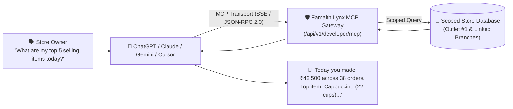

# User Guide: Model Context Protocol (MCP) & AI Assistant Integration (ChatGPT, Claude, Gemini, Cursor)

This guide is written for **Store Owners, Managers, Cashiers, and Business Analysts** using **Famalth Lynx**. It explains how to connect state-of-the-art AI assistants—including **ChatGPT, Anthropic Claude, Google Gemini, and Cursor / AI IDEs**—directly to your store's live database using the **Model Context Protocol (MCP)** and developer API keys.

---

## 📑 Table of Contents
1. [What is Model Context Protocol (MCP) & Why Connect AI?](#1-what-is-model-context-protocol-mcp--why-connect-ai)
2. [Security & Isolation Policy: Single-Outlet & Linked Branch Protection](#2-security--isolation-policy-single-outlet--linked-branch-protection)
3. [Generating Developer API Keys & Client Credentials](#3-generating-developer-api-keys--client-credentials)
4. [Connecting to Custom GPTs / ChatGPT Actions](#4-connecting-to-custom-gpts--chatgpt-actions)
5. [Connecting to Claude Desktop & Cursor via MCP Server](#5-connecting-to-claude-desktop--cursor-via-mcp-server)
6. [Available AI Tools & What You Can Ask](#6-available-ai-tools--what-you-can-ask)
   - [Analyze Store Sales (`analyze_sales`)](#analyze-store-sales-analyze_sales)
   - [Create & Issue Live Order Bills (`create_order_bill`)](#create--issue-live-order-bills-create_order_bill)
   - [Check Inventory & Low Stock (`get_inventory_status`)](#check-inventory--low-stock-get_inventory_status)
   - [Search Product Catalog & Prices (`search_products`)](#search-product-catalog--prices-search_products)
   - [Fetch Order Details & Receipts (`get_order_details`)](#fetch-order-details--receipts-get_order_details)
   - [Customer Loyalty & Credit Insights (`get_customer_insights`)](#customer-loyalty--credit-insights-get_customer_insights)
7. [Real-Life Conversational Prompts](#7-real-life-conversational-prompts)
8. [Frequently Asked Questions (FAQ)](#8-frequently-asked-questions-faq)

---

## 1. What is Model Context Protocol (MCP) & Why Connect AI?

**Model Context Protocol (MCP)** is an open industry standard that enables AI models (like ChatGPT, Gemini, and Claude) to interact with external systems safely. Instead of copy-pasting numbers into spreadsheets, your AI assistant can directly query your live store inventory, analyze today's revenue, check customer credit balances, or even bill a customer order with natural language.



---

## 2. Security & Isolation Policy: Single-Outlet & Linked Branch Protection

Famalth Lynx enforces **Strict Outlet Scoping**:
- **Designated Outlet Only**: An API key or OAuth authorization code is tied to a specific store branch (`outlet_id`).
- **Linked Branch Cluster**: If your store is a multi-branch chain (e.g. Master Flagship with 2 sub-branches), the AI can query authorized linked branches if explicitly allowed, but **NEVER** all unrelated tenants on the server.
- **Zero Global Leakage**: AI models cannot execute destructive commands (like `DROP TABLE`) or access other franchise owners' financial records.

---

## 3. Generating Developer API Keys & Client Credentials

To connect any external AI assistant:

1. Log in to **Famalth Lynx** as an **Admin** or **Store Owner**.
2. Go to **Settings** $\rightarrow$ **Developer & API Keys** (or **System Governance** $\rightarrow$ **Developer Portal**).
3. Click **+ Generate New API Key**:
   - **Key Name**: e.g., `ChatGPT Store Assistant` or `Claude Inventory Bot`.
   - **Assigned Outlet**: Select the branch this AI should manage (e.g., `Outlet #1 - Main Branch`).
   - **Permissions / Scopes**: Select permissions (`orders:read`, `orders:write`, `billing:read`, `reports:read`, `inventory:read`).
4. The system issues:
   - **API Key**: `lynx_live_xxxxxxxxxxxxxxxxxxxxxxxx` (Used for ChatGPT Actions, Claude Desktop, and Cursor)
   - **OAuth Client ID**: `lynx_client_ec35a4d6fabdb12a6236` (Used for ChatGPT OAuth discovery)
   - **Client Secret**: `lynx_sec_xxxxxxxxxxxxxxxxxxxxxxxx` (Used for Token Endpoint authentication)
5. Copy and store these credentials safely.

---

## 4. How to Connect ChatGPT to Your MCP Server

In ChatGPT’s **"Add custom MCP server"** window, enter the following settings:

### 1. Main Connection Settings
| Field | Value |
| :--- | :--- |
| **Connection** | `Server URL` |
| **Server URL** | `https://famalth-lynx-pos.onrender.com/api/v1/developer/mcp/sse` *(or your custom host URL)* |
| **Authentication** | `OAuth` |

> [!TIP]
> After entering the Server URL and selecting OAuth, click **"Retry discovery"**! ChatGPT will automatically detect the authorization endpoints, token URL, and supported PKCE methods via RFC 8414 server metadata.

### 2. Client Registration (If filling manually)
| Field | Value |
| :--- | :--- |
| **Registration method** | `User-Defined OAuth Client` |
| **OAuth client ID** | `lynx_client_ec35a4d6fabdb12a6236` *(from your portal)* |
| **Client secret** | Your secret `lynx_sec_...` *(from your portal)* |
| **Token Endpoint Auth** | `client_secret_basic` |

### 3. Scopes & OAuth Endpoints
| Field | Value |
| :--- | :--- |
| **Auth URL** | `https://famalth-lynx-pos.onrender.com/api/v1/developer/oauth/authorize` |
| **Token URL** | `https://famalth-lynx-pos.onrender.com/api/v1/developer/oauth/token` |
| **Authorization server base** | `https://famalth-lynx-pos.onrender.com` |
| **Registration URL** | *(Leave blank)* |
| **Resource** | *(Leave blank)* |
| **Server supports PKCE (S256)** | **Checked** *(Fully Supported)* |
| **Scopes** | `orders:read, orders:write, billing:read, reports:read, inventory:read` |

---

### Alternative: Custom GPT Action (Fastest Setup)

If you prefer connecting via a standard **Custom GPT Action** (instead of MCP):

1. In ChatGPT **GPT Builder** (`Explore GPTs` $\rightarrow$ `+ Create`), go to **Configure** $\rightarrow$ **Actions** $\rightarrow$ **Create new action**.
2. Click **Import from URL** and paste:
   ```text
   https://famalth-lynx-pos.onrender.com/api/v1/developer/mcp/chatgpt-openapi.json
   ```
   *(Or replace with your store server's URL if running on a custom domain).*
3. Under **Authentication**, configure the following:
   - **Authentication Type**: `API Key`
   - **Auth Type**: `Custom`
   - **Header Name**: `X-API-Key`
   - **API Key**: Paste your live API Key (`lynx_live_...`) from your Developer Portal.
4. All 6 POS & store operations tools populate instantly. Save and test your Custom GPT!

---

## 5. Connecting to Claude Desktop & Cursor via MCP Server

For desktop users using **Claude Desktop** or the **Cursor AI Code Editor**:

### Claude Desktop Configuration:
Open your `claude_desktop_config.json`:
- **macOS**: `~/Library/Application Support/Claude/claude_desktop_config.json`
- **Windows**: `%APPDATA%\Claude\claude_desktop_config.json`

Add the Famalth Lynx remote SSE MCP server:

```json
{
  "mcpServers": {
    "famalth-lynx": {
      "url": "https://<your-server-domain>/api/v1/developer/mcp/sse",
      "headers": {
        "X-API-Key": "YOUR_LYNX_API_KEY_HERE"
      }
    }
  }
}
```
Restart Claude Desktop. You will see a green plug icon with all store tools active.

### Cursor / VS Code MCP Configuration:
In Cursor, go to **Settings** $\rightarrow$ **Features** $\rightarrow$ **MCP Servers** $\rightarrow$ **Add New MCP Server**:
- **Name**: `Famalth Lynx`
- **Type**: `sse`
- **URL**: `https://<your-server-domain>/api/v1/developer/mcp/sse`
- **Headers**: `X-API-Key: YOUR_LYNX_API_KEY_HERE`

---

## 6. Available AI Tools & What You Can Ask

### Analyze Store Sales (`analyze_sales`)
- **What it does**: Computes live sales revenue, invoice counts, average order values, payment mode splits (Cash vs UPI vs Card), hourly sales distribution, and top-selling items.
- **Example Question**: *"How much did we sell yesterday, and what was the payment split between UPI and Cash?"*

### Create & Issue Live Order Bills (`create_order_bill`)
- **What it does**: Matches items against your catalog, verifies prices and taxes, creates an official POS sales order, updates stock levels, and generates a formatted bill receipt.
- **Example Question**: *"Create a bill for John Doe (Phone: 9876543210): 2 Masala Dosas and 1 Filter Coffee paid by UPI."*

### Check Inventory & Low Stock (`get_inventory_status`)
- **What it does**: Inspects warehouse and store shelves for out-of-stock or low-inventory items below your reorder threshold.
- **Example Question**: *"Which products have less than 5 units left in stock?"*

### Search Product Catalog & Prices (`search_products`)
- **What it does**: Looks up product codes, barcodes, rates, and tax percentages.
- **Example Question**: *"What is the current retail price and barcode for Almond Milk 1L?"*

### Fetch Order Details & Receipts (`get_order_details`)
- **What it does**: Pulls up complete line items, tax breakdowns, and customer notes for any past invoice.
- **Example Question**: *"Show me the items and bill amount for invoice #BILL_1042."*

### Customer Loyalty & Credit Insights (`get_customer_insights`)
- **What it does**: Retrieves customer purchase frequency, total lifetime spend, visit history, and unpaid credit balances.
- **Example Question**: *"What is the outstanding credit balance and total lifetime spend for customer Amit Patel?"*

---

## 7. Real-Life Conversational Prompts

Here are everyday commands you can type into your connected assistant:

| Prompt | AI Action Executed Behind the Scenes |
| :--- | :--- |
| *"Give me a morning sales briefing for today."* | Runs `analyze_sales(timeframe: 'today')` and summarizes revenue, order count, and hourly peaks. |
| *"Do we have enough Basmati Rice for the weekend?"* | Runs `search_products(query: 'Basmati Rice')` and reports exact current shelf stock. |
| *"Alert me to any items that need to be reordered today."* | Runs `get_inventory_status(filter: 'low_stock', threshold: 10)` and generates a vendor reorder draft. |
| *"Bill 1 Cold Coffee and 1 Blueberry Muffin for Sarah."* | Runs `create_order_bill` with customer Sarah and returns the new invoice number. |
| *"Does customer Rahul have any unpaid credit bills?"* | Runs `get_customer_insights(name: 'Rahul')` and returns total credit balance and last visit date. |

---

## 8. Frequently Asked Questions (FAQ)

#### Q1: Does the AI assistant require our store server to be public on the internet?
> **A:** If your store runs locally on LAN, you can use local MCP tools in Cursor or Claude Desktop by pointing to `http://localhost:5000/api/v1/developer/mcp/sse`. For cloud ChatGPT Actions, your backend must be hosted on an online server (e.g. on Render, VPS, or a secure Cloudflare tunnel).

#### Q2: Can the AI change product prices without authorization?
> **A:** No. `create_order_bill` automatically verifies rates against your store's `item_master` database. If the assistant specifies an invalid price, the system uses your official catalog price.

#### Q3: What happens if an API key is compromised?
> **A:** Go to **Settings > Developer & API Keys**, locate the compromised key, and click **Revoke / Delete**. All active sessions and tokens generated by that key are invalidated immediately.
