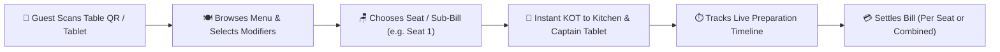

# User Guide: Contactless QR Table Ordering, Multi-Seat & Split-Bill Dining Portal

This guide provides step-by-step instructions for restaurant managers, captains, and diners on using the **Contactless QR Table Ordering System**, the **Dedicated Dining Portal App** (`lib/main_dining.dart`), **Multi-Seat / Split-Bill Ordering**, and **Real-Time Waiter Assistance**.

---

## 📑 Table of Contents
1. [Overview & Why Use QR Table Ordering?](#1-overview--why-use-qr-table-ordering)
2. [Designing & Printing Table QR Codes (With Seat/Bill Badges)](#2-designing--printing-table-qr-codes-with-seatbill-badges)
3. [The Guest Experience: Scanning & Entering the Dining Portal](#3-the-guest-experience-scanning--entering-the-dining-portal)
4. [Multi-Seat & Split-Bill Ordering (Seat 1, Seat 2, Bill Sharing)](#4-multi-seat--split-bill-ordering-seat-1-seat-2-bill-sharing)
5. [Exploring the Menu, Modifiers & Placing Orders](#5-exploring-the-menu-modifiers--placing-orders)
6. [Live Order Progress Timeline (Placed → Kitchen → Served)](#6-live-order-progress-timeline-placed--kitchen--served)
7. [One-Tap Waiter Assistance (Water, Cutlery, Clean Table, Call Waiter)](#7-one-tap-waiter-assistance-water-cutlery-clean-table-call-waiter)
8. [Bill Settlement: Individual Seat Bill vs Combined Table Bill](#8-bill-settlement-individual-seat-bill-vs-combined-table-bill)
9. [Captain Console & Kitchen Coordination](#9-captain-console--kitchen-coordination)
10. [Frequently Asked Questions (FAQ)](#10-frequently-asked-questions-faq)

---

## 1. Overview & Why Use QR Table Ordering?

The **Famalth Lynx Dining Portal** allows customers seated at any table to scan a QR code with their mobile phone or use a dedicated tabletop tablet (`lib/main_dining.dart`) to browse the menu, customize items, submit orders directly to the kitchen, request assistance, and settle bills.



### Key Advantages:
- **Zero App Download Required**: Runs in any modern smartphone browser (Chrome, Safari) or as a dedicated standalone Flutter kiosk tablet.
- **Seat-Level Ordering**: Guests at the same table can order independently under their own seat numbers (`Seat 1`, `Seat 2`) or combine their orders into a single table ticket.
- **Direct Kitchen Routing**: Orders print automatically on thermal kitchen printers and appear on Kitchen Display Systems (KDS) without waiter delay.
- **One-Tap Service Calls**: Guests can summon their server for water, cutlery, napkins, or check requests with a single tap.

---

## 2. Designing & Printing Table QR Codes (With Seat/Bill Badges)

Navigate to **Restaurant / Dining** $\rightarrow$ **Table QR Designer** (`lib/screens/restaurant/table_qr_designer_screen.dart`):

```
+--------------------------------------------------------------------------+
| 🎨 TABLE QR DESIGNER & PRINT STUDIO                                      |
|--------------------------------------------------------------------------|
| Format:      [ Standee Poster | Tent Card | Acrylic Stand | Sticker ]    |
| Theme:       [ Google Modern | Royal Indigo | Luxury Dark | Amber ]      |
| Elements:    [X] Restaurant Logo   [X] Wi-Fi Badge   [X] Cutting Guides  |
| Wi-Fi SSID:  "CafeDelight_5G"          Password: "coffee123"             |
|                                                                          |
| Seat Option: [✓] Generate Per-Seat QR Codes (Seat 1..4 per Table)        |
|                                                                          |
| [ Preview: Table 4 (Seat 1) ]             [ Bulk Print Entire Floor ]    |
+--------------------------------------------------------------------------+
```

### Supported Standee Formats:
1. **Google Style Standee Poster**: Premium branded standee with restaurant name, center logo, and embedded Wi-Fi login badge.
2. **Tabletop Tent Card**: Double-sided freestanding card for dining tables.
3. **Acrylic Standee Insert**: Standard $4 \times 6\text{ inch}$ or A6 dimensions for transparent acrylic holders.
4. **Coaster & Sticker Format**: Compact round or square stickers for outdoor seating, bar counters, or poolside lounges.

---

## 3. The Guest Experience: Scanning & Entering the Dining Portal

When guests arrive at Table 4:
1. Point their smartphone camera at the table QR code, or wake the tabletop tablet running `DiningAppSplashScreen` (`lib/screens/dining/dining_splash_screen.dart`).
2. The dining portal loads instantly with a warm splash animation and displays the restaurant's live branding and greeting.
3. **Guest Choice**:
   - **Quick Guest Mode**: Order immediately without registering.
   - **Customer Sign-In**: Enter phone number or email to earn loyalty reward points and receive a digital receipt.

---

## 4. Multi-Seat & Split-Bill Ordering (Seat 1, Seat 2, Bill Sharing)

A major challenge in dining is handling groups where different people want separate bills:

```
+--------------------------------------------------------------------------+
| 🪑 SELECT YOUR SEAT & BILLING GROUP                                      |
|--------------------------------------------------------------------------|
| Table 4 - AC Dining                                                      |
|                                                                          |
| [ Seat 1 (Bill 1) ]   [ Seat 2 (Bill 2) ]   [ Seat 3 (Bill 3) ]          |
|                                                                          |
| (•) My Own Bill (Items ordered by this phone billed separately)          |
| ( ) Shared Table Bill (All seats combined into one invoice)              |
|                                                                          |
|                         [ CONTINUE TO MENU ]                             |
+--------------------------------------------------------------------------+
```

### How Multi-Seat Ordering Works:
- **Per-Seat Tagging**: When a diner selects **Seat 2**, all items ordered from their device are tagged with `seat: "Seat 2"` and `client_tag: "Bill 2"`.
- **Independent Rounding**: Guests can order extra drinks or appetizers at their own pace without affecting their friend's tab.
- **Combined Visibility**: The Captain Console (`captain_dashboard_screen.dart`) sees both the overall Table 4 status and the itemized breakdown per seat.

---

## 5. Exploring the Menu, Modifiers & Placing Orders

The **Table Dining Screen** (`lib/screens/dining/table_dining_screen.dart`) provides a modern food delivery app experience:

1. **Category Bar**: Easily swipe between *Appetizers*, *Tandoor & Starters*, *Main Courses*, *Beverages*, and *Desserts*.
2. **Dietary Filter Switches**: Tap **Pure Veg (🟢)** to instantly hide non-vegetarian items, or filter by spicy, chef special, or gluten-free.
3. **Customization & Modifiers Dialog**:
   - Tapping an item opens the modifier modal:
     - Portion Size: *Regular* / *Large* / *Platter*.
     - Spice Level: *Mild* / *Medium* / *Extra Spicy*.
     - Add-ons: *Add Extra Cheese (+₹40)*, *Extra Butter Naan (+₹50)*.
     - Cooking Notes: *"Please make without garlic"*, *"Less ice in cocktail"*.
4. **Reviewing Cart**: The floating cart bar displays the total item count and price. Tap **View Cart** to review items before submitting.
5. **Place Order**: Tapping **Submit Order** sends the Kitchen Order Ticket (KOT) directly to the kitchen display.

---

## 6. Live Order Progress Timeline (Placed → Kitchen → Served)

Once submitted, guests can track their food's preparation in real time on the **Active Orders Tab**:

```
+--------------------------------------------------------------------------+
| 📋 ORDER STATUS FOR TABLE 4 (Seat 1)                                     |
|--------------------------------------------------------------------------|
|  [✓] Placed      ──>  [✓] Sent to Kitchen  ──>  [⏳] Preparing           |
|  (19:15 PM)           (19:16 PM)               (Est. 12 mins)            |
|                                                                          |
|  KOT #108:                                                               |
|  • 1x Butter Chicken (Extra Spicy, No Garlic)                  ₹380.00   |
|  • 2x Garlic Naan (Crispy)                                     ₹140.00   |
|  • 1x Fresh Lime Soda (Sweet & Salt)                            ₹90.00   |
|                                                                          |
|  [ + Order More Items ]                            [ 💳 Settle My Bill ] |
+--------------------------------------------------------------------------+
```

---

## 7. One-Tap Waiter Assistance (Water, Cutlery, Clean Table, Call Waiter)

Guests do not need to wave their hands or search for floor staff. The bottom toolbar features **Quick Service Buttons**:

| Action Button | Server Notification on Floor Tablet |
| :--- | :--- |
| **💧 Water** | Chime + Alert: *"Table 4 requests fresh drinking water"* |
| **🍴 Cutlery** | Chime + Alert: *"Table 4 requests extra plates & cutlery"* |
| **🧹 Clean Table** | Chime + Alert: *"Table 4 requests table wipe / clean"* |
| **🧾 Request Bill** | Cashier alert: *"Table 4 requests pre-check bill printing"* |
| **🔔 Call Waiter** | Dedicated waiter notification: *"Table 4 requested general assistance"* |

---

## 8. Bill Settlement: Individual Seat Bill vs Combined Table Bill

When ready to conclude their meal:

### Option 1: Individual Seat Settlement
- If the diner ordered under **Seat 1 (Bill 1)**, they tap **Settle My Bill**.
- The system presents only Seat 1's items and total (e.g. ₹610.00).
- Payment can be completed online via UPI / Credit Card, or marked as **Pay at Table**.

### Option 2: Combined Table Settlement
- The group can tap **View Combined Table Bill**.
- Displays all items ordered across Seat 1, Seat 2, and Seat 3.
- The total bill can be paid in one payment transaction or split equally.

---

## 9. Captain Console & Kitchen Coordination

Floor staff manage QR orders smoothly through the updated **Captain Dashboard** (`lib/screens/restaurant/captain_dashboard_screen.dart`):

1. **Visual Notification**: When a QR order arrives, the table tile turns yellow and shows an **"Online / QR"** badge with the seat number.
2. **Acceptance & Editing**: Waiters can open the table, add additional items, or modify preparation notes before printing the KOT.
3. **Merged Billing**: When finalizing the bill in POS (`salescreen.dart`), the cashier can choose to bill by individual sub-table (`Bill 1`) or merge all seats into a single master invoice.

---

## 10. Frequently Asked Questions (FAQ)

#### Q1: Can a customer add more food after their first order is sent to the kitchen?
> **A:** Yes! Guests simply tap **"+ Order More Items"**. The new items generate a new round KOT (e.g. KOT #109, Revision 2) and append seamlessly to their active table bill.

#### Q2: Can different diners at the same table pay with different payment methods?
> **A:** Yes. Seat 1 can pay via UPI QR code from their mobile phone, while Seat 2 can choose "Pay Cash at Table" when the waiter arrives.

#### Q3: Does QR ordering work if the internet goes down?
> **A:** Yes. The dining portal runs locally on your restaurant's local Wi-Fi router. As long as smartphones are connected to your restaurant's Wi-Fi network, ordering works 100% offline.

#### Q4: What prevents someone outside the restaurant from placing fake orders?
> **A:** Table QR codes can be bound to your restaurant's local Wi-Fi IP range (`192.168.x.x`), and captains have one-touch approval controls on their floor tablets.
