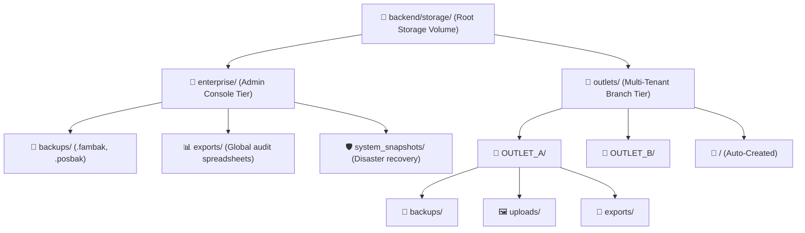
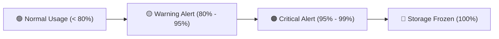

# User Guide: Multi-Tiered Storage Architecture, Outlet File Isolation & Enterprise Backups

This guide is written for **Store Owners, Multi-Branch Franchise Operators, IT Administrators, and SaaS SuperAdmins**. No programming knowledge is required. It explains how the **Famalth Lynx Multi-Tiered Storage Volume** (`backend/storage/`) organizes data into dedicated, isolated tiers, manages automated backups (`.fambak`, `.posbak`), stores media uploads, handles business exports, and monitors storage quotas.

---

## 📑 Table of Contents
1. [Overview & Why Tiered Storage Matters](#1-overview--why-tiered-storage-matters)
2. [Hierarchical Storage Directory Layout](#2-hierarchical-storage-directory-layout)
3. [Enterprise Tier (Admin Console & System Backups)](#3-enterprise-tier-admin-console--system-backups)
4. [Outlets Tier (Multi-Tenant Branch Isolation)](#4-outlets-tier-multi-tenant-branch-isolation)
5. [Backup File Formats Explained (`.fambak` vs `.posbak` vs `.enc`)](#5-backup-file-formats-explained-fambak-vs-posbak-vs-enc)
6. [Managing Media Uploads (Item Images & Invoices)](#6-managing-media-uploads-item-images--invoices)
7. [Business Exports & Closing Reports](#7-business-exports--closing-reports)
8. [Storage Quota Governance & Warning Alerts](#8-storage-quota-governance--warning-alerts)
9. [Frequently Asked Questions (FAQ)](#9-frequently-asked-questions-faq)

---

## 1. Overview & Why Tiered Storage Matters

In multi-branch retail and restaurant chains, different outlets must operate with **complete data privacy and isolation**. An operator at Outlet B should never be able to access, overwrite, or view sales invoices, item photos, or database backups belonging to Outlet A.

At the same time, central headquarters (SuperAdmins, Reseller Owners, and DevOps) need a dedicated, global volume where cross-outlet audit reports, bare-metal disaster recovery snapshots, and consolidated system archives can be stored safely.

Famalth Lynx solves this using a **Two-Tier Storage Architecture**:



---

## 2. Hierarchical Storage Directory Layout

Every Famalth Lynx installation (whether on a local server PC or hosted in cloud container environments) maintains the following strict folder structure under `backend/storage/`:

```text
backend/
└── storage/                                       <── Famalth Lynx Root Storage Volume
    │
    ├── enterprise/                                <── ADMIN CONSOLE DEDICATED TIER
    │   ├── backups/                               <── Complete System Backups (.fambak, .posbak)
    │   │   ├── enterprise_backup_all_*.fambak
    │   │   └── system_full_backup_*.posbak
    │   ├── exports/                               <── Admin cross-outlet consolidated audit exports
    │   └── system_snapshots/                      <── Bare-metal disaster recovery snapshots
    │
    └── outlets/                                   <── MULTI-TENANT OUTLET TIER
        ├── OUTLET_A/                              <── OUTLET_A dedicated folder
        │   ├── backups/                           <── OUTLET_A backups (.fambak, .posbak, .enc)
        │   ├── uploads/                           <── OUTLET_A item images & document receipts
        │   └── exports/                           <── OUTLET_A closing reports & sales CSVs
        │
        ├── OUTLET_B/                              <── OUTLET_B dedicated folder
        │   ├── backups/
        │   ├── uploads/
        │   └── exports/
        │
        └── <OUTLET_CODE>/                         <── Auto-created for EVERY registered outlet
            ├── backups/
            ├── uploads/
            └── exports/
```

---

## 3. Enterprise Tier (Admin Console & System Backups)

Located at `backend/storage/enterprise/`, this directory is restricted to **Master SuperAdmins**, **Enterprise Owners**, and **DevOps Engineers**. Branch cashiers and store managers have zero access to this tier.

### Folders in the Enterprise Tier:
1. **`backups/`**:
   - Stores full-system backups containing all database schemas, all tenant profiles, global license records, and user credentials.
   - Example files: `enterprise_backup_all_2026-11-04.fambak`, `system_full_backup_2026-11-04.posbak`.
2. **`exports/`**:
   - Contains multi-branch consolidated analytics, franchise royalty calculations, and chain-wide financial audit spreadsheets.
3. **`system_snapshots/`**:
   - Bare-metal infrastructure snapshots used by automated cloud backup workers to rebuild the entire platform from scratch after catastrophic hardware failure.

---

## 4. Outlets Tier (Multi-Tenant Branch Isolation)

Located at `backend/storage/outlets/`, this tier contains subdirectories automatically provisioned for every registered store branch:

### Automatic Provisioning:
- When a new outlet is created (via the Outlet Setup Wizard or Control Plane), the system automatically creates:
  - `storage/outlets/<OUTLET_CODE>/backups/`
  - `storage/outlets/<OUTLET_CODE>/uploads/`
  - `storage/outlets/<OUTLET_CODE>/exports/`
- All terminal operations are sandboxed to that outlet's dedicated path.

### Benefits of Outlet Isolation:
- **Zero Cross-Contamination**: Branch A cannot view or delete Branch B's files.
- **Selective Restore**: If Outlet A suffers a localized power failure, the administrator can restore only Outlet A's `.fambak` backup without restarting or affecting Outlet B.
- **Clean Archiving**: If a branch location is decommissioned, its single folder can be zipped and archived cleanly.

---

## 5. Backup File Formats Explained (`.fambak` vs `.posbak` vs `.enc`)

Famalth Lynx uses three purpose-built backup file formats:

| Format | File Extension | Structure & Purpose | Typical Use Case |
| :--- | :--- | :--- | :--- |
| **Famalth Enterprise Archive** | `.fambak` | Gzip-compressed, multi-table JSON archive with embedded schema manifest, table metadata, and media references. | Selective outlet migration, scheduled cloud snapshots, and pre-restore inspection. |
| **Standard POS Snapshot** | `.posbak` | Fast, lightweight binary snapshot of operational transactions, open tables, and daily cash ledgers. | Quick end-of-day shift backup taken by cashiers before closing the counter. |
| **Encrypted Raw Dump** | `.enc` | AES-256 encrypted raw PostgreSQL pg_dump binary with cryptographic salt and initialization vector (IV). | Bare-metal server disaster recovery sent to private off-site Google Drive. |

---

## 6. Managing Media Uploads (Item Images & Invoices)

Located at `storage/outlets/<OUTLET_CODE>/uploads/`:
- **Product Photos**: When uploading dish or merchandise images in Item Master, files are stored here with randomized SHA-256 filenames to prevent collision.
- **Supplier GRN Bills**: Scanned paper delivery notes and vendor invoices attached to Goods Receiving Notes (GRN).
- **Prescription Attachments**: Scanned diagnostic reports and laboratory attachments in the Clinic module.

---

## 7. Business Exports & Closing Reports

Located at `storage/outlets/<OUTLET_CODE>/exports/`:
- **Daily Night Audit CSVs**: End-of-day sales, payment mode reconciliations, and tax splits.
- **GSTR-1 / VAT Summaries**: Formatted tax spreadsheets ready for accountant filing.
- **Stock Take Physical Count Sheets**: Excel exports comparing system stock vs physical shelf counts.

---

## 8. Storage Quota Governance & Warning Alerts

To prevent servers from running out of disk space, Famalth Lynx includes an automated **Storage Quota Service** (`storageQuota.service.ts`):



### Quota Thresholds:
1. **Normal ($< 80\%$)**: System operates normally.
2. **Warning ($80\% - 95\%$)**: An informational banner appears on the branch dashboard urging the manager to download and purge old backups.
3. **Critical ($95\% - 99\%$)**: High-visibility alert. Automated background backups prune historical snapshots older than 30 days automatically.
4. **Frozen ($100\%$)**: New non-critical uploads (such as high-res images) are temporarily paused until storage is upgraded or old files are pruned. POS billing is **never locked**.

---

## 9. Frequently Asked Questions (FAQ)

#### Q1: Where is the `storage/` directory located on Windows?
> **A:** On a standard Windows installation, it is located at `C:\FamalthLynx\backend\storage\` (or `C:\Program Files\Famalth Technologies\Famalth Lynx\backend\storage\`).

#### Q2: Can I back up the entire `storage/` folder to an external USB drive?
> **A:** Yes! Copying the entire `backend/storage/` folder to an external drive creates a 100% complete, portable snapshot of all branch files, images, and backups.

#### Q3: Does deleting an outlet delete its storage folder automatically?
> **A:** No. As a data protection safeguard, when an outlet is deactivated, its `storage/outlets/<OUTLET_CODE>/` directory is preserved on the hard drive for audit compliance. Only a SuperAdmin can manually delete the folder.
